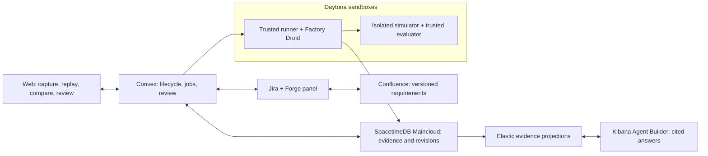

# ForkSafe

ForkSafe helps an engineer understand why a robot task failed and review a
possible controller fix. Start with a recorded collision, let independent
investigation environments gather evidence, then compare the original and a
candidate against separate evaluation cases. Every finding should point back to
its experiment, artifacts and controller version. A person makes the final
decision; an agent's explanation is not a passing test.

The browser can show a recorded fixture story without cloud accounts. The local
benchmark runs real MuJoCo physics. Those are different things: a fixture replay
is not a newly executed simulation, and a healthy cloud endpoint is not proof
that the whole repair pipeline ran.

## Five-minute quickstart

You'll need Node 22+, pnpm 10.34.8 (the version in `packageManager`), uv and
Python 3.12. First-time downloads may take longer than five minutes.

```sh
pnpm run setup
pnpm run doctor
VITE_FORKSAFE_DATA=fixture pnpm dev
```

Open <http://localhost:5173>. Choose **Panda clips divider**, scrub the baseline
replay, then explore **Environments**, **Evidence**, and **Compare & review**.
The banner tells you this is recorded fixture data. Reviews in this mode stay in
your browser. See the [demo runbook](docs/demo-runbook.md) for a guided tour.

Use **pnpm run setup** and **pnpm run doctor**: pnpm reserves bare `setup` and
`doctor` for its own commands. Setup installs dependencies, syncs Python, fetches
and verifies pinned assets, and creates the ignored `.env.local` if absent.
Missing optional CLIs print install hints. SpacetimeDB's CLI is required for
workspace typecheck:

```sh
curl -sSf https://install.spacetimedb.com | sh -s -- -y
export PATH="$HOME/.local/bin:$PATH"
curl -fsSL https://app.factory.ai/cli | sh
```

`pnpm dev` starts Vite on 5173, simulator on 8000 and evaluator on 8001.
Ctrl-C stops all three. It does not start Convex, SpacetimeDB, or cloud workers.
Without `VITE_CONVEX_URL`, the web selects fixtures; setting
`VITE_FORKSAFE_DATA=fixture` explicitly keeps the tour in fixture mode even if a
hosted URL is configured. For a hosted UI, remove that override and set the URL.

## How the pieces fit

This is the intended wiring, not a claim that every link is deployed.
See the [integration matrix](docs/integration-matrix.md) for current limits.



## Commands

Root scripts load `.env.local`, then `.env`, without replacing nonempty process
variables. Keep real credentials out of git and out of `VITE_*` variables.

| Command | What it actually does |
| --- | --- |
| `pnpm run setup` | Install Node/Python dependencies, fetch and verify assets, check CLIs, create env file. |
| `pnpm run doctor` | Report modes and missing names; blocked integrations are warnings. |
| `pnpm run doctor --live` | Add read-only probes; failed configured probes exit 1. |
| `pnpm run doctor --strict --json` | Machine-readable readiness; blocked integrations also exit 1. |
| `pnpm dev` | Start web and both local Python services; stop together on exit. |
| `pnpm seed:demo` | Run Convex `demo:seed` if available; currently exits 2 because `convex/demo.ts` is absent. |
| `pnpm build` | Run workspace build scripts. |
| `pnpm typecheck` | Workspace type checks; generates SpacetimeDB bindings if missing. |
| `pnpm lint` | Workspace lint scripts where defined; not a substitute for tests. |
| `pnpm test` | Workspace Vitest suites, then Python pytest. |
| `pnpm test:integration` | Offline contracts/adapter/helper tests; live tests skip with reasons. |
| `INTEGRATION_LIVE=1 pnpm test:integration` | Also run configured read-only Convex, Elastic, Jira and Maincloud tests. |
| `pnpm test:e2e` | Fixture browser story on desktop/mobile; Playwright starts Vite itself. |
| `pnpm benchmark` | Real baseline simulator fallback, or evaluator benchmark module if added. Prints completed/failureKinds/wall time. |
| `pnpm daytona:prepare` | Prepare images/snapshots; needs a Daytona key and may create resources. |
| `pnpm smoke:hosted` | Read-only endpoint probes, not a full repair or sandbox experiment. |
| `pnpm cleanup:sandboxes` | Dry-run owned sandbox list; `--yes` deletes exact ForkSafe-labelled resources only. |

For Python alone use `node scripts/pytest.mjs`. A reproduced baseline collision is
an expected benchmark result and exits 0; a crash or unparseable result fails.
Set `EVALUATOR_SERVICE_TOKEN` before authenticated evaluator operations.
Health endpoints do not need it.

CI runs without secrets: typecheck, workspace/integration tests, pinned-asset
Python tests, web build and fixture Playwright tests. Install Chromium locally:
`pnpm --filter @forksafe/web exec playwright install --with-deps chromium`.

## Connect a development cloud account

Use an authorized development project, not production. Vendor menu wording may
change; these are the places to look. Save values in `.env.local` or a secret
manager, never in terminal history, screenshots or an issue. A local env file
does not configure secrets inside a hosted deployment or worker.

### Convex

1. Open the [Convex dashboard](https://dashboard.convex.dev), select your project,
   then the development deployment.
2. Open **Settings → URL & Deploy Key**, generate a deployment key, and save
   `CONVEX_DEPLOY_KEY`. A development deploy key is not an admin key.
3. Copy the deployment URL into `CONVEX_URL` and `VITE_CONVEX_URL`; put its
   HTTP actions URL in `CONVEX_SITE_URL`. The existing authorized dev deployment
   uses `https://giant-jellyfish-684.convex.cloud` and
   `https://giant-jellyfish-684.convex.site`.
4. Configure server-side integration secrets under **Settings → Environment
   Variables**. Keep `CONVEX_MODE=cloud`; run `pnpm run doctor --live`.
   The shared package readiness contract still asks for `CONVEX_ADMIN_KEY`
   separately. Do not put a development deploy key in that field just to clear
   its warning; the public health probe needs neither key.

### Daytona

1. Open the [Daytona dashboard](https://app.daytona.io), select your organization,
   then **API Keys**. Create a development key and save `DAYTONA_API_KEY`.
2. Keep `DAYTONA_API_URL=https://app.daytona.io/api` unless your account uses a
   different endpoint. Use `DAYTONA_MODE=cloud`.
3. Read the [adapter guide](docs/integrations/daytona.md) before
   `pnpm daytona:prepare`; set the resulting runner/execution snapshot names in
   `DAYTONA_RUNNER_SNAPSHOT` and `DAYTONA_EXECUTION_SNAPSHOT`.
   Listing sandboxes is read-only; preparing snapshots is not.

### Factory

1. Sign into [Factory](https://app.factory.ai), open account/organization
   **Settings → API Keys**, and create a development key.
2. Set `FACTORY_API_KEY`, `FACTORY_MODE=cloud`, and optionally `FACTORY_MODEL`.
   Install Droid with the command above.
3. Doctor intentionally says **not verified** with a key present. SDK model
   discovery returned models for an invalid key too, so it does not verify
   authentication. Real tool/session work remains a separate checkpoint.

### Elastic Serverless and Kibana

1. In [Elastic Cloud](https://cloud.elastic.co), select or create an
   **Elasticsearch Serverless** project. Open **Connection details** on its
   overview; copy the Elasticsearch endpoint to `ELASTICSEARCH_URL`.
2. Open **API keys** from connection details or Kibana management.
   Create a least-privilege key for the ForkSafe indices and save its **encoded**
   value as `ELASTICSEARCH_API_KEY`, not the key ID.
3. Click **Open Kibana**; copy its base URL to `KIBANA_URL` without an application
   path. Root doctor uses the Elasticsearch key for Kibana, with
   `KIBANA_API_KEY` as an optional fallback.
4. Keep `ELASTIC_MODE=cloud` and `ELASTIC_AGENT_BUILDER_MODE=cloud`. For the
   package Agent Builder adapter, also bind that authorized key as
   `KIBANA_API_KEY`: its contracts currently require that name separately.
   The [Elastic guide](packages/integrations/elastic/README.md) covers index
   permissions and scoped read-only agents. A successful agents-list probe
   does not establish evidence indexing or a cited answer.

### Atlassian: Jira and Confluence

1. Visit [Atlassian account security](https://id.atlassian.com/manage-profile/security/api-tokens),
   choose **Create API token**, and save `ATLASSIAN_API_TOKEN`. Use an account
   with access to the development project; save its email as `ATLASSIAN_EMAIL`.
2. Open Jira and copy the site base URL, such as
   `https://your-team.atlassian.net`, to `ATLASSIAN_SITE_URL`.
   The adapter uses email/token Basic auth at that site; an OAuth/scoped token
   that requires a different API gateway is not interchangeable.
3. Open **Project settings → Details** (or space details in newer navigation).
   Save the project **key**, not display name, as `ATLASSIAN_PROJECT_KEY`.
4. Set `ATLASSIAN_MODE=cloud`. Confluence requirements need access to the page;
   preserve its page ID and revision. The Jira project probe does not verify
   Confluence access or issue writes.

### Forge Jira app

1. Open the [Atlassian developer console](https://developer.atlassian.com/console/myapps/),
   choose **Peyton ForkSafe**, and find registered app
   `66bb7292-9ddc-4529-aa0f-db7b15fc667a`. Set `FORGE_APP_ID` to that public ID.
2. Follow [apps/forge/README.md](apps/forge/README.md) to log into Forge CLI,
   configure its HTTPS Convex remote, build, deploy, and install into an authorized
   Jira development site. The checked-in remote URL is a placeholder.
3. Select remote mode only after the backend is configured. The default panel
   is a labelled fixture; an app ID alone does not mean it is installed.

### SpacetimeDB Maincloud

1. Install the CLI above, ensure `~/.local/bin` is on PATH, then run
   `spacetime login`. Open its browser link and choose the authorized account.
2. Follow [the publish guide](docs/publish-spacetimedb.md) to publish
   `packages/spacetimedb` as `forksafe` on Maincloud. Supply
   `FORKSAFE_BRIDGE_SECRET` through the deployment secret mechanism, not source
   control. Never use a data-deletion flag on an existing database.
3. Keep `SPACETIMEDB_URI=wss://maincloud.spacetimedb.com`,
   `SPACETIMEDB_DATABASE=forksafe` and `SPACETIMEDB_MODE=cloud`. Configure matching
   bridge settings in Convex. HTTP discovery is not proof that the authenticated
   bridge can read or commit canonical evidence.

## What is ready?

Read-only probes returned HTTP 200 for Convex, Maincloud database discovery,
Daytona sandbox listing, Elasticsearch, Kibana agents listing and the Jira
project. Factory remains unverified. The fixture browser story and offline
adapter tests are separate from those probes; this is not a claim of an
end-to-end hosted repair.

See [integration modes and limits](docs/integration-matrix.md),
[troubleshooting](docs/troubleshooting.md), and the
[demo runbook](docs/demo-runbook.md). For design intent and security boundaries,
start with the [PRD](docs/ForkSafe_PRD_Handoff.md) and
[implementation status](IMPLEMENTATION_STATUS.md).
