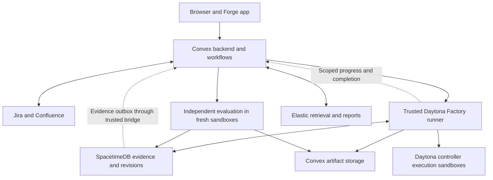
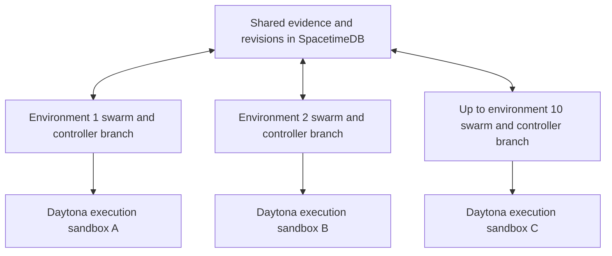
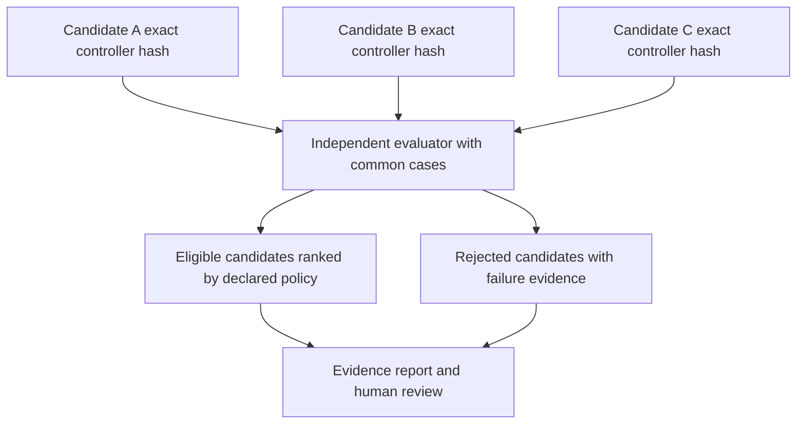

# ForkSafe PRD and implementation handoff

Version 1.2 · October 24, 2026

This is a self-contained handoff for implementing ForkSafe. Part A resolves implementation choices and tells a fresh coding agent where to begin. Part B contains the full product requirements, updated throughout for the selected Convex and Daytona architecture, including customer journeys, sponsor roles, and acceptance criteria. The older DOCX is not the architecture authority for this version. No earlier chat, separate image files, or source DOCX is required to understand this handoff.

**Precedence:** Follow applicable user instructions and repository guidance. For implementation choices, the concrete defaults in Part A resolve any remaining illustrative configurations in Part B. Do not ask the user to choose frameworks, agent roles, database, robot type, or UI layout. Use these defaults, document necessary adjustments, and proceed. Missing credentials are a live-integration limitation, not a reason to stop all implementation. External account authorization or a genuinely inaccessible dependency may still require user action; never invent credentials or report fixture behavior as live integration.

## Part A — Start here

### A1 Product and settled decisions

ForkSafe investigates failed robot simulations. Capture a reproducible failure; launch independent environments; let each environment run a small swarm that can explore any permitted hypothesis; share evidence; submit exact controller versions; evaluate those versions independently; return a candidate and its evidence for human review.

The initial customer is a robotics software engineer in a student lab or small manipulation team. The main outcome is an inspectable, reproducible repair recommendation. User research and time-saving claims remain unvalidated until measured.

| Choice | Implement this |
|---|---|
| Core stack | Factory Droid SDK, Convex, Daytona, SpacetimeDB, Elastic, and Atlassian Forge/Jira/Confluence. |
| State ownership | Convex owns investigation/job lifecycle, execution leases, budgets, retries, and workflow progress. Keep SpacetimeDB for shared evidence, controller revisions/write leases, findings, candidates, evaluation evidence, and review records. Never give both databases authority over the same mutable field. |
| Retrieval and reporting | Elastic. Moss is an optional future alternative, not an MVP dependency. |
| Environments | Configurable 1–10 per investigation, default 3. Demonstrate 3 before increasing load to 10. |
| Swarms | All environments have the same permitted tool capabilities. No permanent geometry/speed/perception specialties. |
| Sessions | Default 2 agent sessions per environment, maximum 3; global active model-call cap 4 initially. Sessions can delegate and revise hypotheses. |
| Physics | Authoritative Python MuJoCo backend; browser renders its state or replays. |
| Robot | Franka Emika Panda from Google DeepMind MuJoCo Menagerie, pinned to a recorded commit. |
| First task | Move one rigid cube around a divider into a target region. |
| Code changes | Only task controller and explicitly allowed helper files. Evaluation rules, assets, dependencies, and hidden cases are protected. |
| Frontend | React, TypeScript, Vite, Three.js, and ordinary CSS modules. |
| Backend and orchestration | Convex functions, HTTP actions where needed, Workflow, and Workpool. Node.js 22 TypeScript runner in trusted Daytona sandboxes. Python 3.12 MuJoCo runner in separate execution sandboxes; FastAPI is a local-development adapter only. |
| Runtime agents | Factory TypeScript Droid SDK (`@factory/droid-sdk/node`) and installed `droid` CLI in the trusted runner. Default 2 sessions per environment; no second agent framework. |
| Hosting | Local physics spike first; hosted backend is Convex, with Daytona for trusted runners and separate generated-code execution. Use existing Daytona credits subject to actual quota. Vultr and Render are not required. |
| Frontend hosting | Vite static build; use Vercel as the default static-host target when deployment is authorized. This does not add a Vercel sponsor requirement. Local development remains on port 5173. |
| Artifact storage | Convex file storage for the hosted MVP; local filesystem adapter for development. Store hashes and authorized references in SpacetimeDB. Never rely on a sandbox disk as the sole durable copy. |
| Human interaction | One user can run the whole flow. Human multiplayer, live co-editing, and a separate teaching app are outside MVP. |
| Final authority | A deterministic evaluator establishes pass/fail. Elastic explains recorded results. A human accepts a specific evaluated candidate. |
| Output | Patch, immutable artifact references, comparison results, replays, and Jira review evidence. No automatic repository merge or physical deployment. |

Resolve compatible dependency versions at bootstrap using official documentation, pin them in lockfiles, and record them. Do not copy version-sensitive SDK signatures from this handoff as if they were vendor APIs. Public example names below are application contracts to implement.

Use Zod 3 for the Factory SDK tool schemas as required by its checked documentation; do not automatically upgrade those schemas to an incompatible major version. The global active-call cap refers to application-issued SDK session turns. Report any additional provider-internal activity separately rather than claiming visibility or control that the SDK does not expose.

### A2 First actions for the implementing agent

1. Inspect the workspace and applicable `AGENTS.md` files. If it already contains ForkSafe, continue there without replacing unrelated work. Otherwise create `./forksafe`.
2. Create a short `IMPLEMENTATION_STATUS.md` with milestones, current blockers, integration modes, and the next action. Preserve it between sessions.
3. Scaffold the monorepo described below, shared schemas, a checked `.env.example`, and the root commands. Begin with a local simulator and browser, not cloud provisioning.
4. Load the Panda asset, implement one successful transfer and one actual collision case, and save/reload the simulator state. Verify a known pose and coordinate transform in the browser.
5. Implement independent evaluation before the repair loop. A controller that stops or moves the divider must not pass.
6. Add Convex-backed jobs and attempt leases, SpacetimeDB evidence/revision reducers, immutable artifacts, and one real Factory SDK tool round trip. Validate one Daytona headless experiment when credentials are available.
7. Extend to three unrestricted investigation environments, shared findings, candidate comparison, and external integrations. Run Factory in trusted Daytona runners and generated controller code in distinct execution sandboxes. Exercise the cross-service recovery contract in A7.
8. Run the acceptance checks in A11. Deliver runnable code, setup instructions, a labeled demo, and an honest status of each sponsor integration. Do not finish with only a scaffold, diagrams, or a plan.

Do not stop to ask optional design questions. When a choice is not specified, choose the smallest implementation consistent with this contract and record the decision. Do not weaken isolation or change the task family silently to make a test pass.

### A3 Repository and commands to implement

| Path | Responsibility |
|---|---|
| `apps/web` | Scenario setup, live environment grid, evidence feed, candidate comparison, replay, and review UI. |
| `convex` | Backend functions, auth checks, Workflow/Workpool configuration, job leases, budget reservations, HTTP callbacks, artifact storage, and durable orchestration outbox. |
| `apps/runner` | Trusted Node.js Daytona runner: Factory SDK sessions, permissioned tools, SpacetimeDB bridge, sanitized events, and sandbox execution gateway. No generated controller code executes in this process. |
| `apps/forge` | Real Jira issue panel and resolver; selected Confluence context and reviewer action. |
| `packages/contracts` | Shared TypeScript types, Zod validators, serialized event and result schemas. |
| `packages/spacetimedb` | Canonical evidence/revision tables, write leases, scoped execution grants, permission checks, durable projection outbox, and generated bindings. No second environment-job scheduler. |
| `packages/agents` | Factory adapter, sessions, tools, prompts, permissions, and usage accounting. |
| `packages/integrations` | Daytona provisioning/execution, Elastic, Jira, Confluence, Convex storage, and local artifact adapters. |
| `services/simulator` | Python MuJoCo scene loading, skills, command-line experiment runner, trace export, and replay state; optional local FastAPI adapter. |
| `services/evaluator` | Trusted evaluation runner; never mounted into repair-agent workspaces. |
| `controllers` | Baseline task controller and allowed source helpers. Candidate code is copied into isolated revision directories. |
| `assets/robots` | Pinned robot model, hashes, license, and asset-import script. |
| `evaluation` | Versioned public and withheld manifests, grader configuration, and access policy. |
| `tests` | Contract, coordination, isolation, integration, and browser story checks. |
| `scripts` | Setup, local startup, seeding, cleanup, doctor, benchmark, and Daytona image/snapshot preparation. |
| `infra/daytona` | Versioned trusted-runner and execution image definitions, snapshot IDs, resource defaults, and lifecycle policies. |

Use pnpm workspaces for TypeScript and uv with a lockfile for Python. Expose root commands with these meanings; these are project scripts the implementing agent must create:

```bash
pnpm setup                 # install, resolve/pin dependencies, prepare assets and generated bindings
pnpm doctor                # report prerequisites and integration readiness without printing secrets
pnpm dev                   # browser, Convex local/dev backend, local runner, SpacetimeDB and simulator
pnpm seed:demo             # create demo project, baseline, requirements and failure scenario
pnpm test                  # meaningful contract and unit checks
pnpm test:integration      # real local physics + coordination tests
pnpm test:e2e              # browser capture -> investigation -> comparison -> review
pnpm benchmark             # record actual single-vs-parallel results and usage
pnpm build                 # TypeScript checks and production frontend build
pnpm daytona:prepare       # explicit image/snapshot preparation using configured authorized credentials
pnpm smoke:hosted          # one live Factory tool round trip and one real Daytona physics experiment
pnpm cleanup:sandboxes     # stop/delete only ForkSafe sandboxes owned by this project/run
```

Default local ports: web 5173, optional local simulator HTTP adapter 8000, SpacetimeDB 3000, Elasticsearch 9200. Use the actual Convex local/dev URL emitted by its tooling rather than assuming a port. No standalone production Fastify server is required. Make local ports configurable. Local artifacts live under `var/artifacts`, workspaces under `var/workspaces`, and transient logs under `var/logs`; ignore these directories in git. Use content-addressed artifacts rather than embedding replay blobs in coordination rows.

### A4 Local modes and missing credentials

Local mode must still run actual MuJoCo physics, SpacetimeDB, and a real Convex local/dev backend. Use the supported Convex local workflow when available; otherwise use a configured development deployment and label it accordingly. It is not an animation pretending to be a simulator. Provide a deterministic `FixtureAgentAdapter` only for orchestration development when Factory credentials are missing. Fixture-generated experiments and candidate suggestions are labeled **FIXTURE AGENT** everywhere; they do not establish sponsor use or model autonomy. Physics and evaluator outcomes must always be measured.

| Integration | Local behavior | Live completion requirement |
|---|---|---|
| Factory | Labeled scripted tool requests through the same broker interface. | Droid SDK sessions perform actual experiments or controller edits and submit a real candidate. |
| Convex | Real local/dev backend with the same job/workflow functions used in hosted mode. | A real investigation creates jobs, enforces external-worker concurrency, recovers a failed attempt, and triggers evaluation. |
| SpacetimeDB | Real local CLI instance and published module. Do not silently replace it with in-memory state. | Independent swarms share findings and use atomic revision/write ownership against the selected deployment. |
| Elastic | Actual local Elasticsearch for indexing/search when available; a labeled fixture adapter permits UI progress otherwise. | Agent Builder on an accessible Serverless instance answers an evidence question using real data. |
| Atlassian | Clearly labeled local issue/requirements fixture records. | A deployed Forge app performs real Jira and selected Confluence operations. |
| Daytona | Local container adapter permits development when credentials are unavailable; it does not count as Daytona use. | Trusted runner and separate execution sandboxes run real work from prepared images, enforce limits, persist artifacts, and clean up. |

Implement a backend health endpoint listing each adapter as `live`, `local`, `fixture`, `disabled`, or `unavailable`. Missing credentials should produce a precise readiness item. Do not ask for secrets in chat, make purchases, create accounts, publish a site, or claim deployment merely to satisfy this handoff.

The following configuration contract is proposed for ForkSafe. Use current vendor tooling for provider-specific deployment credentials; do not invent their values. `FACTORY_API_KEY` is the documented Factory SDK environment variable. The `DAYTONA_*` snapshot and cap fields below are ForkSafe adapter configuration, not assumed SDK parameter names:

```dotenv
APP_MODE=local
WEB_PORT=5173
CONVEX_URL=
VITE_CONVEX_URL=
CONVEX_SITE_URL=
DAYTONA_MODE=local
DAYTONA_API_KEY=
DAYTONA_API_URL=
DAYTONA_RUNNER_SNAPSHOT=
DAYTONA_EXECUTION_SNAPSHOT=
DAYTONA_MAX_ACTIVE_SANDBOXES=5
DAYTONA_EXECUTION_CONCURRENCY=3
RUNNER_MODE=local
ARTIFACT_MODE=local
RUNNER_CALLBACK_SECRET=
SIMULATOR_URL=http://127.0.0.1:8000
SPACETIMEDB_URI=ws://127.0.0.1:3000
SPACETIMEDB_DATABASE=forksafe
ARTIFACT_ROOT=./var/artifacts
FACTORY_MODE=fixture
FACTORY_API_KEY=
ELASTIC_MODE=local
ELASTICSEARCH_URL=http://127.0.0.1:9200
ELASTICSEARCH_API_KEY=
ELASTIC_AGENT_BUILDER_MODE=disabled
KIBANA_URL=
KIBANA_API_KEY=
ATLASSIAN_MODE=fixture
FORGE_APP_ID=
ATLASSIAN_PROJECT_KEY=
INTEGRATION_SHARED_SECRET=
MAX_ENVIRONMENTS=10
DEFAULT_ENVIRONMENTS=3
MAX_ACTIVE_MODEL_CALLS=4
```

Store the Daytona account key in Convex server-side configuration. Trusted runners request scoped provisioning/execution operations through authenticated Convex actions; do not give them account-wide Daytona authority. Integration credentials remain in trusted backend processes. Factory credentials belong only to trusted runner processes, never generated-code execution sandboxes or browser bundles. Mint narrow, expiring runner grants rather than injecting a Convex admin/deploy key or unrestricted SpacetimeDB identity. Use an authenticated broker for workers. `VITE_CONVEX_URL` is public endpoint configuration, not a secret. Resolve the matching Convex client/deployment URL and HTTP action URL from tooling; these are different endpoint types. A4 values are development defaults, not an instruction to copy localhost URLs into hosted sandboxes. Choose the Factory SDK's configured/default supported model initially; record the resolved model identity. Do not guess model identifiers or assume a third-party model endpoint can be substituted into Factory without adapter support.

### A5 Simulation contract and default task rules

Load `franka_emika_panda/panda.xml` or its official scene from MuJoCo Menagerie, preserving relative mesh references. Record the upstream commit and asset hashes. Use SI units and a canonical Z-up frame. A browser rendering in Y-up must apply a documented transform to every body and quaternion. Physics is authoritative on the server; the browser cannot submit a test score.

Default fixed physics timestep is 0.002 seconds. Run high-level control every 0.01 simulated seconds and sample the selected preview at 10 Hz. Headless experiments do not wait for real-time rendering. Every experiment starts a fresh process or fully restored clean state and captures controller-internal state as well as simulator state.

Create a floor, supported cube start pose, divider, and marked target. Implement a deterministic calibration/fixture-generation script that selects reachable poses from the pinned model: the reference controller must complete the nominal task, and a divider change must cause a real forbidden contact. Commit the selected scene configuration and seed, not a hardcoded failure outcome. If setup fails, debug the model/controller and record a blocker; do not switch to another robot silently.

For MVP reliability, an explicitly declared **idealized grasp** is allowed: attach the cube only after the end-effector is within 20 mm of the intended grasp pose and a close-gripper skill has completed. Represent the attachment in the snapshot and manifest, including force/constraint state. Do not claim realistic grip-force or sim-to-real validation. The cube must remain subject to obstacle contact checks during transfer.

| Rule | Default |
|---|---|
| Task completion | Cube center within 30 mm of target center, supported or settled, for 0.5 simulated seconds. |
| Task timeout | 30 simulated seconds. |
| Forbidden contact | Robot-divider, robot-wall, or cube-divider penetration over 1 mm for five consecutive physics steps. |
| Allowed contact | Explicit gripper-cube, support-cube, and fixed-base support pairs; enumerate by named geometry IDs. |
| Joint and command limits | Use limits from the pinned model; reject out-of-range, NaN, and non-finite commands. |
| Stopping early | Fails if task completion is not achieved. |
| Invalid run | Engine crash, missing artifact, invalid scene, or missing required measurements; never a pass. |

These values are initial implementation decisions, not validated safety thresholds. Version the evaluator manifest before searching. Editing the evaluator or scene invalidates comparison with an earlier run.

### A6 Swarms and tool interface

Each environment has independent code revisions, experiment history, budgets, and agent sessions. One lead session can delegate to another session; either may inspect any permitted hypothesis. Variation may come from evidence order, prompts, or chosen experiments. Do not hardcode one environment to investigate speed and another to investigate geometry.

Expose application tools with validated schemas:

| Tool | Inputs and effect |
|---|---|
| `inspect_failure` | Baseline ID; return permitted trace, scene, controller and failure references. |
| `read_source` | Allowed relative path and revision; return source. |
| `apply_patch` | Expected revision, allowed paths, patch; create new immutable revision under an active write lease. |
| `run_experiment` | Controller hash, approved scene overrides, seed, replication flag; queue a sandbox run. |
| `publish_finding` | Claim, scope, observation/inference type, evidence IDs; append canonical finding. |
| `search_evidence` | Query and scope; retrieve through Elastic, then validate canonical source IDs. |
| `fork_candidate` | Candidate ID; create an explicit child revision and record lineage. |
| `submit_candidate` | Exact revision/hash and evidence IDs; freeze candidate within submission limits. |
| `request_subtask` | Bounded task and budget; start another session if caps allow. |

Use Factory's documented SDK/MCP tool mechanism and inspect installed type declarations before coding calls. Names above describe ForkSafe tools, not existing Factory methods. Sessions call the broker rather than receiving an unrestricted host shell. Editable paths initially include only `controllers/task_controller.py` and `controllers/skills/` helpers approved in a manifest. Block traversal, symlink escapes, dependency changes, and attempts to edit scene/evaluation assets. One writer owns a revision; concurrent edits require explicit child branches.

Every result identifies its investigation, environment, task, attempt, controller hash, scene hash, seed and evaluator version. Agent confidence is not a pass condition. Findings can be supported, contradicted, replicated or superseded without deleting their provenance. Share concise evidence and decisions, not private chain-of-thought.

### A7 Coordination, runtime placement, and service contracts

#### Single owner for each kind of state

| Owner | Canonical records and decisions |
|---|---|
| Convex | Investigation lifecycle, environment job status, dependencies, execution attempts/leases, cancellation epoch, time/token reservations, active-turn and sandbox admissions, provisioning operations, workflow progress, and integration dispatch acknowledgements. |
| SpacetimeDB | Baseline/requirement metadata, branch revisions and controller write leases, findings and relationships, experiment evidence, immutable candidates, evaluator-authored result evidence, approved memories, and human review records. Execution grants mirror Convex admissions and are permission fences, not a separate scheduler. |
| Convex file storage / local artifact adapter | Immutable bytes addressed by content hash. SpacetimeDB carries authorized references. Keep held-out inputs separately permissioned. |
| Elastic | Rebuildable authorized evidence projections and explanations. It owns no job state or scores. |

Use the same application UUIDs across services. Display-only copies carry `source_system`, source version, and projection timestamp; never let a projection become an alternative write authority. The browser reads permissioned Convex queries for lifecycle and scoped SpacetimeDB subscriptions for evidence, joined by investigation/environment IDs. Review readiness requires both completed lifecycle conditions and a valid exact evaluation record.

Implement Convex application functions for `create_investigation`, `start_investigation`, `claim_job`, `heartbeat_job`, `complete_job`, `expire_job`, `cancel_investigation`, `reserve_model_turn`, and `release_model_turn`. Mutations make atomic state transitions; actions perform external calls. Use Workflow for durable multi-step orchestration and Workpool for bounded eligible function work. Do not execute Python physics or start the local Droid CLI inside Convex actions. Convex actions have per-invocation limits; Workflow durability does not create a persistent host process. [S12-S14]

Implement SpacetimeDB reducers for `register_baseline`, `install_execution_grant`, `revoke_execution_grant`, `claim_revision`, `heartbeat_revision`, `release_revision`, `commit_revision`, `publish_finding`, `record_experiment`, `submit_candidate`, `record_evaluation`, `record_review`, and projection-outbox acknowledgement. Reducers check project scope, expected revision, role, and the scoped execution grant where relevant. They never launch Factory, call Daytona, make API requests, or run physics. SpacetimeDB does not own environment-job claims or retries. [S2-S3]

#### Attempts, concurrency, and the cross-service handoff

Each Convex job has authenticated worker ID, integer `attempt`, lease expiry, and investigation cancellation epoch. Heartbeat every 5 seconds; expire after 30 seconds; permit one infrastructure retry initially. Increment the attempt on reclaim. Completion checks owner, attempt, lease, epoch, and investigation state atomically in Convex. A stale attempt cannot complete a current job.

Before a worker writes active branch state, the trusted bridge installs a matching scoped grant in SpacetimeDB with job ID, attempt, environment, epoch, allowed operations, and expiry. Acknowledge grant installation before starting work. Extend grants only after a successful Convex heartbeat. On reclaim/cancel, revoke the old grant or wait for its expiry before installing a replacement; serialize these projection operations for that job. SpacetimeDB independently checks grant validity and revision/write ownership on each relevant write. Revision write leases default to a 30-second expiry and 5-second renewal, bounded by the execution grant's expiry. Never tell repair agents to bypass this check because the databases disagree.

There is no transaction across Convex and SpacetimeDB. Model the handoff explicitly: admission reserved → grant installed → work started → artifacts persisted → evidence committed → completion acknowledged. Use durable operation IDs and reconciliation so a crash between stages resumes rather than creates duplicate work. If grant synchronization is unavailable, stop new admission and let existing grants expire. Cancellation immediately stops Convex admission; show `cancel_requested` while revocation and process termination are pending, then `cancelled` after acknowledgement or enforced expiry. Do not promise instantaneous revocation across services.

Workpool limits concurrent Convex function executions. A dispatch action that starts an external Daytona process and returns does not keep an environment slot occupied. Maintain transactional active-job, active-turn, and active-sandbox reservations until confirmed completion/termination or recovery. Do not release a sandbox capacity reservation merely because an API call timed out; reconcile the remote object first. Retry uses the same operation ID and checks an existing provisioning record/remote labels before creating another sandbox.

#### Runtime placement and sandbox defaults

Use one trusted Daytona runner sandbox per investigation initially. It runs Node.js 22, `@factory/droid-sdk/node`, the installed compatible `droid` CLI, permissioned application tools, and the SpacetimeDB bridge. Factory sessions are independent logical agents hosted by this runner; each has a separate working context and is associated with one environment. Do not run imported controller modules or other generated code in the trusted runner. Shell execution and unrestricted built-in file tools must be disabled/restricted for investigation sessions; the tool broker validates paths and routes approved code operations to separate workspaces. Prompt instructions alone are not enforcement. [S1]

Use a separate Daytona workspace/execution sandbox for each active investigation environment, prepared from a pinned MuJoCo image. The trusted runner requests its commands through the scoped Convex Daytona adapter, collects sanitized logs and measured outputs, and commits permitted evidence. Commands execute asynchronously; poll or stream bounded result chunks rather than holding a Convex action open for an entire investigation. The adapter checks sandbox ownership, environment, attempt, command policy, and resource reservation. Agents do not receive Daytona account keys, Convex admin keys, broad SpacetimeDB credentials, Jira credentials, or evaluator secrets. The swarm is logically associated with its workspace even though SDK sessions live in the trusted runner.

Initial resource requests: trusted runner 2 vCPU / 4 GiB RAM / 10 GiB disk; each execution sandbox 2 vCPU / 4 GiB RAM / 10 GiB disk; one experiment process at a time per environment. These are provisional adapter settings to validate against account limits and observed workload, not vendor guarantees. Default active sandbox cap 5 (one runner, three investigation workspaces, and one reserved evaluation slot); sandbox count is distinct from the 1–10 investigation-environment cap. Increasing to ten environments requires an adequate quota and resource budget. Reuse workspace sandboxes across development experiments only with full clean simulator/controller reset; create fresh execution sandboxes for final evaluation. Preserve a CPU-first headless path and measure before adding GPU rendering.

On submission close, checkpoint and stop repair sessions/workspaces as appropriate to release capacity. Run `services/evaluator` in a separate trusted Daytona sandbox under a verifier identity, with no repair-agent sessions or tools, and execute candidate controllers in separate fresh execution sandboxes. Both evaluator and execution sandboxes count toward the cap; admit final cases sequentially initially. Keep the trusted scoring harness and credentials outside the controller process's writable/accessible paths. A controller's self-reported success is never a score. Withheld inputs are available only to this final evaluation path, not to the Factory repair runner or its retrieval tools.

Factory session data and SDK tool attachments require deliberate lifecycle handling: persist session state/checkpoints outside an about-to-be-deleted runner when resumption is needed, reattach permission handlers and MCP tools on resume, and mark a session interrupted if its recoverable state is missing. Never claim a fresh conversation resumed the prior session. Stream sanitized tool calls/results, concise plans, diffs, and usage; do not publish private chain-of-thought. One session supports one active turn, so concurrent agents require separate sessions. [S1]

Daytona snapshots prepare software/filesystem dependencies; they are not the MuJoCo baseline snapshot. Restore joint positions, velocities, object poses, actuator/controller state, and seed from the signed experiment manifest every run. Configure lifecycle timers explicitly to cover the bounded investigation, enforce hard execution deadlines, export durable artifacts before cleanup, and label all sandboxes by project, investigation, environment, attempt, and purpose. Cleanup enumerates only owned labels. [S15-S17]

#### Application API and integration delivery

Use generated Convex client functions for browser operations. The names below are application contracts to implement, not built-in vendor methods. Expose HTTP actions only for authenticated external integrations and callbacks; no standalone hosted Fastify API is required.

The trusted SpacetimeDB bridge is a reusable runner capability, not an assumption that a repair session stays alive forever. While investigating it runs with the trusted Factory runner; final evaluation has its own scoped bridge identity. When no runner is active, Convex can admit a short-lived trusted bridge-only Daytona job for evidence reads, review commits, outbox delivery, or grant reconciliation. It runs no Factory sessions, receives only the signed operation and scoped identity it needs, and counts toward sandbox capacity. This keeps evidence/review operations available after repair compute has been cleaned up without requiring a Render service. Grant installation/revocation is performed only by the authorized bridge path, never directly by agent-issued tools.

| Interface | Behavior |
|---|---|
| `health` query / optional `GET /health` HTTP action | Adapter readiness and limits without secrets. |
| `investigations.create/start/cancel` mutations | Baseline reference, budget, expected version, and idempotent intent capture. |
| `investigations.get/list` queries | Permissioned current lifecycle snapshots; reactive subscriptions for progress. |
| `workers.claim/heartbeat/complete` internal or authenticated HTTP bridge | Scoped runner identity, attempt fencing, receipts, and durable completion. Never expose worker authority to browser clients. |
| `POST /callbacks/daytona` HTTP action | Verify configured provider authentication when using provider events. Treat provider status as a lifecycle hint, never proof a measured experiment passed. Poll through the adapter if callbacks are unavailable. |
| `evidence.search` action | Query Elastic and validate authorized canonical SpacetimeDB IDs through the trusted bridge. |
| `candidates.get/compare` application read path | Resolve exact evidence records in SpacetimeDB and current lifecycle in Convex. |
| `reviews.record` application command | Authenticate reviewer, validate evaluated hash/version, commit canonical review in SpacetimeDB, then update lifecycle through a retryable acknowledgement. |
| `artifacts.upload/download` authenticated actions | Scoped upload grants, permission-checked download responses, and immutable content-hash validation using Convex storage in hosted mode. |

The Python runner accepts content-addressed controller artifacts, approved scene parameters and seed, and returns a run manifest with metrics and artifact references. Use a CLI/JSON contract in Daytona; an HTTP FastAPI adapter may serve local development. Test TypeScript/Python serialization. HTTP response arrival, process launch, and sandbox readiness are not proof that a durable experiment completed.

For private artifacts, use an authenticated HTTP action that checks current authorization before serving bytes. Do not expose permanent `storage.getUrl()` bearer URLs for withheld cases or revocable evidence, and do not claim those URLs expire automatically. Chunk large traces/replays into files no larger than 8 MiB for this MVP so proxy responses stay comfortably within the documented HTTP-action response limit. Storage IDs are internal references; keep project/visibility/hash metadata and an indexing receipt in Convex, linked to the canonical evidence ID. Public robot meshes may use ordinary public hosting. [S18]

Use a durable SpacetimeDB evidence outbox for indexing events and canonical review notifications. The trusted bridge delivers each operation into Convex using its stable ID; Convex dispatches Elastic/Jira effects and acknowledges the source event only after the handoff is recorded. Reconcile delivered-but-unacknowledged events. Convex-originated provisioning and lifecycle notifications use its own durable operation records. Every envelope includes event/operation ID, project ID, entity ID, source system/version, attempt/epoch when relevant, type, timestamps, and artifact references. There is no cross-service exactly-once guarantee.

### A8 Candidate aggregation and evaluation defaults

Default search budget is 10 minutes wall time, 20 development experiments per environment, and 2 submitted candidates per environment. Admit up to 3 final candidates after deduplication and public-suite comparison. Model budget is separately configurable and enforced at admission; unknown usage must be labeled rather than counted as zero.

Start with a 100,000-token investigation allowance, including a 20,000 output-token sublimit, and at most 2,000 output tokens per application-configured turn when supported. Count SDK-reported usage across all environments and reserve budget before admitting a new turn. Treat these as configurable operational limits, not a price estimate; token counts do not imply a fixed currency cost. If the runtime cannot provide a reliable hard limit, disclose the enforcement limitation and retain conservative turn and time limits.

Freeze a public suite containing the original failure plus 9 nearby or ordinary scenarios. Default variation ranges are divider position by ±30 mm, cube start position by ±20 mm, and timing/speed cases within approved controller limits. Generate 8 additional withheld cases from the same declared domain using a seed available only to the evaluator. Store actual generated manifests, ranges and hashes. Reject invalid/unreachable cases during suite construction before evaluating candidates, never after observing a candidate outcome.

1. Verify each candidate artifact, allowed changes, baseline and clean installation.
2. Replay the original failure and all public cases with the same criteria.
3. Deduplicate by exact controller hash, retaining all contributing lineage.
4. Freeze at most three public-suite survivors before withheld evaluation.
5. Evaluate each survivor once on the same withheld set. Do not expose hidden case details to repair agents or let them iterate on these outcomes. A new round needs fresh withheld cases.
6. A candidate is eligible only if every required case is valid and passes completion, contact and limit checks. Zero motion cannot pass.
7. Among eligible candidates, prefer fewer changed controller functions, then lower median successful completion time, then stable candidate ID. Show tradeoffs and all counts. This ordering is a review policy, not proof of real-world safety.
8. If none passes, report unresolved. Never invent a winner. Combining patches creates a new candidate requiring full reevaluation.

Store structured per-case results with success, validity, failure reasons, collision events, completion time, controller/scene/evaluator hashes and artifact IDs. The final report must distinguish public-suite eligibility, final-suite result, and human acceptance.

### A9 Sponsor implementation boundaries

| Sponsor | Real responsibility and proof |
|---|---|
| Factory | Live SDK sessions perform investigation and controller work; capture tool IDs and candidate artifacts. Fixture agents do not qualify as live use. |
| Convex | Live backend/workflow creates and monitors Daytona jobs, enforces external-work reservations, handles an interrupted attempt, and starts independent evaluation. |
| SpacetimeDB | Real shared evidence, subscriptions, scoped grants, and atomic controller revision/write ownership. Demonstrate one swarm using another swarm's finding and a stale-grant/write rejection. |
| Atlassian | A deployed Forge Jira issue panel starts an investigation and records review. Fetch selected Confluence pages with revision IDs. Local issue fixtures do not count. |
| Elastic | Real finding/trace retrieval and an Agent Builder Serverless evidence question/report with canonical citations. Local Elasticsearch alone does not prove Agent Builder integration. |
| Daytona | Actual trusted runner and separate MuJoCo/generated-code sandboxes with image IDs, measured resource usage, lifecycle records, and cleanup evidence. Existing credits do not imply unlimited quota. |

Elastic indices should distinguish `findings`, `experiments`, `candidates`, `requirements`, and optionally `memories`, with project and robot scope, canonical ID, revision, status and timestamps. ES|QL tools suit exact metrics; index-search tools suit evidence discovery. Provide application-backed tools for authoritative result/replay lookup. Indexing lag must not restore revoked access or make stale results current. Do not assume free text search automatically supplies embeddings or semantic indexing; start with useful keyword and metadata retrieval, adding semantic search only with a configured model and measured need.

The report generator retrieves measured data and explains it. It cannot change scores or approve candidates. When Agent Builder is unavailable, display a deterministic summary as a labeled fallback and mark the live sponsor milestone incomplete.

Forge uses a resolver-side integration, never browser-exposed shared secrets. Validate the authenticated Forge request using the chosen documented Forge Remote mechanism or a narrowly scoped resolver-to-API authenticated channel. Map trusted user context to project permissions and reviewer grants. Do not trust a browser-supplied account ID. Use selected Confluence page revisions as context; convert enforceable requirements into versioned rules and mark the remainder for human review.

Convex and Daytona are now selected dependencies. Moss, voice, cross-issue learning, additional model providers, and human demonstration collection remain optional future work. Vultr and Render are not required. Treat Daytona as credited infrastructure; confirm event sponsor/prize status separately. Atlassian remains a selected product integration, but verify the applicable challenge rather than assuming a current Cal Hacks prize track. Do not add integrations solely to increase sponsor count.

### A10 User interface and evidence artifacts

Use a restrained engineering dashboard: light background, dark text, blue for active work, green for passing, amber for incomplete, red for failures, and text labels in addition to color. Desktop has navigation, central environment/replay workspace, and evidence/detail panel; small screens stack panels. Support keyboard controls and readable tables. Avoid ornamental 3D effects that obscure the robot or evidence.

Required screens: investigation list; failure capture/scenario editor; environment grid; selected environment with agents/experiments; shared findings; candidate comparison; before/after replay; Jira/Forge issue panel; adapter readiness. No human multiplayer or voice is required.

Export `manifest.json`, `controller.patch`, `results.json`, `report.md`, public evaluation manifest and replay references. Store withheld inputs separately; never include them in an agent-accessible export during active search. A recorded demo must name the actual investigation and candidate IDs and be labeled recorded.

### A11 Completion checklist and work order

Implement in order: simulator success/failure and replay; fixed evaluator; single runtime repair; three-environment coordination; shared evidence retrieval; comparison; Forge integration; Elastic Agent Builder report; capacity and recovery checks. Work may be divided among implementation contributors where permitted by their environment, but the product's investigation swarms must not be replaced by hardcoded outcomes.

- A fresh local setup can seed and reproduce one nominal success and one actual failure.
- The full customer journey, physics/evaluation contract, and product constraints below are implemented using the selected architecture; the older DOCX must not restore superseded hosting or ownership decisions.
- Three environments operate concurrently without workspace contamination and can change hypotheses freely.
- A finding published in one environment is retrieved in another, with experiment provenance.
- All candidate scores come from the protected evaluator; unchanged scenes and hashes are checked.
- Convex claims and budget reservations, expired execution leases, stale callbacks, grant revocation in SpacetimeDB, retries, cancellation, and failed cross-service handoffs are exercised.
- One real Daytona experiment and one live Factory SDK repair are recorded; trusted runner and generated-code execution remain separate.
- Capacity reservations survive ambiguous provisioning responses; orphaned owned sandboxes are reconciled and cleaned up.
- The README identifies Factory SDK entry points, runtime trigger, permitted tools, actual diffs, experiment results, and known integration limitations.
- The original failure, public cases and withheld cases have per-case measured outcomes.
- Browser capture → investigation → evidence → candidate comparison → review works end to end.
- Sponsor fixtures, local services and live APIs are distinguishable in UI and logs.
- Repository instructions include installation, commands, credentials, adapter modes, known limitations, benchmark reproduction and actual validation results.
- Missing live access is reported precisely after completing independent work. Do not ask routine product-choice questions or claim unperformed tests passed.

The implementing agent should deliver code and actual verification results. This Markdown file itself is a specification, not an already implemented repository. The scripts, endpoints and configuration in Part A must be created and tested; they are not claimed to exist yet.

## Navigation

- Part A is the implementation contract above.
- Part B below is the complete product PRD, revised consistently with Part A; the three architecture diagrams are standalone Mermaid blocks.
- Official links in the PRD are references for installed SDK behavior, not substitutes for the product decisions in Part A.

---

## Part B — Complete product requirements

### ForkSafe Product Requirements Document

Parallel robot failure investigation and verified controller repair

Version 1.2 | October 24 2026 | Product proposal and implementation specification

ForkSafe turns a reproducible robot simulation failure into parallel investigations, candidate controller repairs, and evidence for an engineer to review. Up to ten isolated environments run their own swarms of agents. Every environment may investigate any plausible explanation, publish findings, adopt evidence from other branches, and propose repairs. A separate evaluator compares exact controller versions under common conditions.

The selected stack is Factory, Convex, Daytona, SpacetimeDB, Elastic, and Atlassian. Convex owns backend orchestration and job lifecycle. Daytona hosts trusted Factory runners and separate isolated simulation/code-execution environments. Factory performs runtime investigation and controller repair. SpacetimeDB preserves shared findings, branch revisions, candidate and evaluation evidence, and review records. Atlassian connects the work to Jira issues and Confluence requirements. Elastic retrieves evidence and produces grounded explanations; a deterministic verifier establishes pass/fail. Vultr and Render are not required. Moss remains an optional later alternative, not a second MVP retrieval system.

The first release supports one simulated robot and one task family. It returns a candidate for human review rather than deploying controller changes to physical hardware. The architecture supports ten environments; the first end-to-end milestone demonstrates three before increasing concurrency.

#### Product decisions

| Decision | Requirement |
| --- | --- |
| Parallelism | Configurable one to ten investigation environments per issue. |
| Exploration | All environments can use the full permitted investigation toolkit. No environment is permanently assigned a specialty. |
| Agent behavior | Each swarm can delegate work, revise hypotheses, run experiments, and submit candidates within its budget. |
| Sharing | Publish evidence with scope and provenance. Adoption of another branch's code is explicit. |
| Selection | Independent tests establish eligibility; a declared ranking policy orders passing candidates. |
| Customer interface | Browser investigation workspace plus a Forge app in Jira and a persistent engineering assistant. |
| Retrieval integration | Elastic handles evidence and knowledge retrieval. Moss is an optional alternative, not a second MVP requirement. |
| Workflow ownership | Convex owns investigation/job lifecycle and external-execution admission. |
| Evidence ownership | SpacetimeDB owns shared evidence and controller revision/write ownership; it is not a competing job scheduler. |
| Compute | Daytona provides trusted runner sandboxes and separate controller-execution sandboxes. |

All numerical thresholds in this document are proposed acceptance targets or illustrative configurations. They are not measured product results. Customer pain and willingness to adopt remain hypotheses to validate through interviews and a small pilot.

### 1 Problem and customers

#### Customer problem

A robotics engineer encounters a task that succeeds under ordinary conditions but fails for a particular obstacle arrangement, package position, or controller sequence. The engineer must preserve the case, reproduce it, explore possible causes, modify code, and establish that the change does not break other cases. Evidence often spans simulator logs, code changes, issue discussions, and operating requirements.

ForkSafe addresses that investigation workflow. Parallel search is useful when there are several plausible explanations or repairs, and running separate experiments is less costly than waiting for each explanation to be explored sequentially. Parallelism is a product hypothesis to evaluate against an equally budgeted single-environment baseline.

#### Initial customer and job

The initial user is a robotics software engineer on a student lab or small manipulation team that already has a runnable simulator, a controller repository, and a repeatable task. The reviewer is a technical lead who needs to inspect a candidate change and the evidence behind it. The initial customer profile is intentionally narrower than all robot developers.

When a simulated task fails, the engineer wants to hand the reproducible case to ForkSafe, set modification boundaries and a resource budget, and receive a candidate controller version with a clear account of what was tested. The reviewer wants to compare that candidate with the original behavior without reconstructing every experiment.

#### Existing approaches and proposed value

| Existing approach | Limitation ForkSafe will test |
| --- | --- |
| Manual experiments | Engineer time is consumed coordinating reproduction and comparisons. |
| A coding agent with logs | It may produce a plausible patch without preserving physical evidence or testing comparable cases. |
| Agents sharing one workspace | Concurrent modifications and moving baselines can make results hard to attribute. |
| Simulator dashboard | Visibility alone does not carry a failure through repair, verification, and review. |

#### Discovery before pilot

Interview three to five target engineers. Ask them to reconstruct a recent failure, identify which artifacts were missing, estimate investigation effort, and inspect the proposed candidate report. Record baseline effort from observed work where possible. Do not treat interview estimates as measured time savings. Pilot success requires an engineer to reproduce a submitted candidate and understand its limitations without a builder explaining the run.

### 2 Customer journey

The customer can enter through a failed run in the browser or an existing Jira issue. Both routes create one investigation with a frozen baseline and a visible resource budget.

| Stage | Customer action | ForkSafe response |
| --- | --- | --- |
| Connect | Select repository, Jira project, approved Confluence pages, and robot assets. | Validate access, model loading, task execution, and editable paths. |
| Capture | Reproduce a collision, timeout, dropped object, or task failure. | Save the scene, state, controller version, logs, and failure definition. |
| Configure | Select environment cap, time limit, model budget, and review policy. | Estimate resource demand and show the investigation boundaries. |
| Launch | Start investigation from the browser or Forge app. | Create independent environments and the initial agent sessions. |
| Observe | Inspect active experiments and ask evidence questions. | Show findings, failed attempts, candidate versions, and current costs. |
| Compare | Open the finalists after submission closes. | Run the fixed evaluation and compare passing and rejected candidates. |
| Review | Inspect diff, original replay, candidate replay, and limitations. | Record approval, rejection, or a request for further investigation. |
| Continue | Submit a later failure and reference earlier constraints. | Retrieve approved preferences and relevant verified lessons, with sources. |

#### Concrete example

An engineer shifts a divider in a packing scene. The arm clips it while moving a package. The engineer captures the run, chooses three active environments with a cap of ten, and permits edits only to the task controller. Different swarms explore path geometry, timing, state estimation, or other explanations as they choose. One publishes a useful experiment; another reproduces it and develops a candidate. The original scene remains unchanged for final evaluation.

The engineer receives a comparison showing which candidates failed, which passed the locked cases, and which code version is recommended. Approving the recommendation marks it accepted for simulation review. It does not merge code or activate a physical robot. A separate export action produces a patch and report for the team's normal engineering process.

#### Incomplete journeys

If the case cannot be reproduced, ForkSafe requests the missing state or marks the investigation nonreproducible. If no candidate passes, the result is an unresolved issue with useful findings. If budget expires or the user cancels, ForkSafe preserves completed evidence and labels unfinished evaluations explicitly.

### 3 Browser and assistant experience

#### Failure capture

The browser displays an authoritative simulation replay and an optional live preview. A scenario editor changes named parameters between runs, never silently during a recorded experiment. Capture shows the controller version, scene version, failure timestamp, and reason. Starting an investigation requires a reproducibility check and a budget confirmation within the product.

#### Investigation workspace

An environment grid displays up to ten environments. Each tile shows active agents, current experiment, elapsed time, model usage, and candidate count. Small previews are sampled or replayed; the browser does not calculate ten independent authoritative worlds. Opening a tile shows its experiment timeline and code branch.

The shared findings feed displays claims, scope, evidence links, contradiction notices, and replication status. It separates observed outcomes from agent interpretations. The interface shows concise decisions and tool outcomes rather than private model chain-of-thought. Filters include environment, controller version, hypothesis, and result.

#### Candidate review

The comparison view shows the original replay beside a selected candidate, synchronized by simulation time. It includes the exact diff, applicable requirements, test-suite identity, collisions, task completion, and completion time. Missing or failed tests remain visible. Acceptance controls require a human reviewer and an unexpired result for the exact candidate hash.

#### Persistent engineering assistant

The assistant answers questions such as 'Why was candidate 7 rejected?' and accepts scoped commands such as 'Investigate this issue using my approved modification limits.' It retrieves evidence through Elastic, resolves the returned IDs against authoritative records, and calls permission-checked application tools. It cannot override test outcomes, budgets, or file permissions through conversation.

Explicit preferences and approved lessons carry across issues: permitted controller paths, preferred reports, and scoped lessons associated with a robot and software version. The user can inspect, correct, or delete these memories. Jira, Confluence, and repository access remains limited to the selected project. Voice is a later option, not required for the first workflow.

If a later version adopts Moss, this assistant gives it a plausible Personal Agent role across the engineer's tools. Moss's examples emphasize voice and personal assistants; backend retrieval alone is weaker alignment. Confirm that framing with the sponsor before relying on prize eligibility. Persistent memory is a P1 capability and is not required for the first repair workflow.

### 4 Scope and functional requirements

P0 requirements define the first usable release. P1 requirements extend scale or evidence quality after the core flow works.

| ID | Priority | Requirement and acceptance condition |
| --- | --- | --- |
| FR01 | P0 | Capture a full failure manifest and reproduce its failure class under pinned settings. |
| FR02 | P0 | Support an environment cap from one to ten; demonstrate three concurrent environments before scaling. |
| FR03 | P0 | Every environment can investigate any permitted hypothesis and change strategy without reassignment. |
| FR04 | P0 | Support multiple agent sessions per environment with controlled file and experiment ownership. |
| FR05 | P0 | Publish and retrieve findings with experiment IDs, scope, author, and verification status. |
| FR06 | P0 | Submit an immutable controller candidate with baseline and artifact hashes. |
| FR07 | P0 | Verify candidates with a separate, noneditable evaluator and original scene. |
| FR08 | P0 | Rank eligible candidates by an explicit policy and retain rejected results. |
| FR09 | P0 | Provide a Forge workflow with Jira linkage and versioned Confluence requirements. |
| FR10 | P0 | Use Elastic for retrieval and evidence investigation; disclose unavailable retrieval or reporting. |
| FR11 | P0 | Support stop, timeout, bounded retries, recovery, and partial-result reporting. |
| FR12 | P0 | Human review records the exact patch and evaluated version; no automatic hardware deployment. |
| FR13 | P1 | Scale an investigation to ten active environments within configured compute and API budgets. |
| FR14 | P1 | Preserve approved memories across separate investigations and support correction and deletion. |
| FR15 | P1 | Compare parallel search with a single-environment baseline under matched budgets. |
| FR16 | P1 | Minimize a failing scene and benchmark retrieval and scheduling strategies. |
| FR17 | P0 | Convex owns job lifecycle and admits bounded Daytona execution; demonstrate recovery and capacity enforcement after an ambiguous dispatch. |
| FR18 | P0 | Factory SDK runs in a trusted Daytona runner, generated controllers execute separately, and actual session actions/diffs/results are visible. |

#### First release exclusions

Physical robot deployment, arbitrary robot models, new policy training, full humanoid locomotion, unrestricted repository editing, automatic patch merging, human multiplayer, and a general-purpose remote development platform are outside the first release. The demonstration may change scene parameters to create a failure; changing the scene cannot count as repairing the controller.

#### Definition of a usable result

A reviewer can reconstruct the baseline, inspect a candidate, replay its behavior, identify the checks run, and either accept it for further engineering review or leave the issue unresolved. A generated narrative without executable artifacts does not meet this requirement.

### 5 System architecture

Separate durable workflow state, shared investigation evidence, trusted agent execution, generated-code execution, and independent verification. The browser is a viewer and control surface. Authoritative physics runs in Daytona execution sandboxes; Factory SDK processes run in distinct trusted Daytona runners.



| Component | Authoritative responsibility |
| --- | --- |
| Browser and Forge app | User actions, replay display, issue context, and review interface. |
| Convex | Authenticated backend functions, durable lifecycle/workflow state, task admission/attempts, execution leases, budgets, provisioning, cancellation, and external-effect dispatch. |
| SpacetimeDB | Shared evidence, scoped branch/revision ownership, execution-grant checks, findings, candidates, evaluator-authored results, and human review records. |
| Trusted Daytona runner | Node.js application hosting real Factory SDK sessions, permissioned tool broker, SpacetimeDB bridge, and sanitized activity streams. |
| Daytona execution sandboxes | Independent controller workspaces and actual Python MuJoCo experiments. No broad integration credentials or SDK-controller execution here. |
| Independent evaluator | Fixed scoring rules and final test outcomes; invokes fresh execution sandboxes and commits immutable evidence under a verifier identity. |
| Elastic | Rebuildable evidence search, experiment investigation, and grounded comparison reports. |
| Convex file storage | Hosted immutable artifact bytes: controller versions, traces, replay files, manifests, and exports. A local adapter supports development. |

The runtime coordinator is application logic implemented in Convex plus the trusted runner, not a separate hosted Fastify server. Use Workflow and Workpool for suitable function steps; persist external-job capacity separately until Daytona work actually ends. Local processes are development adapters, not proof of live Daytona integration. Factory is the selected agent runtime; no additional agent framework is required. [S1 S12-S17]

Jira remains the team's engineering work record. Convex owns operational lifecycle, and SpacetimeDB owns investigation evidence and reviews. Their synchronization is an explicit, retryable handoff with stable IDs and source versions. No operation is atomic across them. A stale projection, delayed Jira update, or Elastic index cannot change a measured outcome or authorize a new attempt. See A7 for the admission/grant/completion protocol.

### 6 Simulation and browser architecture

#### Recommended execution path

Use MuJoCo Python in backend workers for the manipulation task and a browser viewer built with React, TypeScript, and Three.js. Start with a tested arm model from MuJoCo Menagerie and pin the model files and license information. Implement a small working task controller using bounded robot skills and inverse kinematics. The first scenario transfers a rigid object around a divider into a destination region. [S6-S8]

Physics advances at a fixed timestep chosen during the engine spike, independently of rendering and model API latency. The browser receives sampled body transforms and interpolates visual motion. Use a consistent coordinate convention, object IDs, and asset manifest; explicitly transform MuJoCo coordinates into the viewer convention. Test a known pose, distance, and contact point before trusting a replay.

Agents request experiments through a simulator tool API. They do not command every motor through an LLM call. A worker can run headless and faster than the displayed replay when feasible. Render selected camera frames only when needed for visual diagnosis. Display a sampled preview or recorded replay rather than requiring full video streams from all ten environments.

#### Snapshot manifest

Each baseline captures model and asset hashes, engine and dependency versions, integration settings, full relevant simulator state, controller state, input sequence, random seeds, and task success criteria. Include external forces, actuator state, and stochastic inputs when applicable. Exact bitwise replay across different engines or machines is not promised. The reproduction check must preserve the failure class and key measurements within declared tolerances. Missing state makes a case nonreproducible, not a verified failure.

#### Alternative architectures

| Option | Use and tradeoff |
| --- | --- |
| Backend MuJoCo plus browser viewer | Recommended. One authoritative engine for agent experiments and final evaluation; requires backend compute and replay synchronization. |
| MuJoCo WebAssembly in browser | Optional local authoring preview. Useful browser physics but still requires isolated server workers for trusted multi-agent evaluation; bindings are documented as work in progress. |
| Rapier with a simple mobile robot | Fallback task if arm setup fails. Faster scenario setup but changes the robot and controller scope; label it a different task family. |

Choose one authoritative physics engine for the MVP. Do not compare candidates scored by different engines as if the results were equivalent. [S9-S10]

### 7 Environment and swarm architecture

An environment is an isolated experiment workspace linked to the original failure. It contains a controller branch, simulator endpoint, experiment history, artifact namespace, budget, and a small set of agent sessions. It is not assigned a permanent type of failure to investigate.



Every environment can investigate any permitted hypothesis. Convex admits and tracks these environment jobs; Factory sessions execute in the trusted runner and use tools against the corresponding Daytona workspace. Each simulator executes immutable run inputs; code adoption across environments is explicit and versioned.


#### Agent operation

A swarm begins with one lead session and may delegate bounded subtasks to additional Factory sessions. Investigation, code editing, and local checking are available capabilities rather than permanent environment specialties. All environments may explore geometry, timing, controller state, perception assumptions, or another permitted explanation. They may abandon hypotheses and adopt scoped findings from peers.

The initial concurrency target is up to three agent sessions per environment, with a separate global cap. Agents spend much of their time waiting on tools or simulations; thirty configured sessions do not require thirty simultaneously active model calls. Start with one or two active sessions per environment until coordination is reliable.

#### Workspace discipline

Only one agent may hold a controller write lease for a workspace revision. Other agents use read-only access or explicit child branches. Each simulation loads an immutable candidate artifact, so an edit cannot change a run already in progress. Tool calls include the investigation, environment, attempt, and controller identifiers.

Generated code executes in a dedicated Daytona execution sandbox; the Factory SDK controller and its credential remain in a distinct trusted Daytona runner. Use the placement, grants, and resource/lifecycle defaults in A7. Agents access approved commands and experiment APIs through a broker. They cannot edit evaluator code, read withheld scenarios, alter other environments' files, or update accepted review decisions.

#### Maintaining useful diversity

Initial context can differ in evidence ordering, open questions, or exploration prompts without limiting available tools. Share observations and provenance promptly. Code adoption is explicit: a swarm can fork another candidate while preserving its own history. Exact experiment reservations reduce accidental repetition; deliberate replication is allowed and marked as such. Measure whether this design finds more useful distinct repairs than a single equally budgeted agent. [S1]

### 8 Shared findings and knowledge retrieval

#### Publishing a finding

A finding contains a concise claim, observed or inferred status, applicable conditions, evidence run IDs, controller and scene hashes, authoring environment, and timestamp. An agent's confidence is descriptive, not a substitute for replication. Use states such as proposed, supported in observed runs, independently replicated, contradicted, and superseded. Contradictory evidence appends a relationship rather than silently overwriting the original claim.

Example: 'At speeds tested in runs 18, 21, and 24, contact still occurred with the original divider and package pose.' This is stronger evidence than 'Speed is irrelevant,' because it states what was actually tested.

#### Canonical and searchable records

Publishing a finding commits the record and an indexing event in SpacetimeDB. An external indexing worker projects the authorized record into Elastic. Separate indices or document types distinguish findings, procedures, experiment events, and approved memories. Records carry stable IDs and metadata; full replays and controller artifacts remain in artifact storage. Elastic is a retrieval layer, not the task queue or source of current review state. [S3 S5]

Agents and the engineering assistant query Elastic-backed tools for relevant findings, procedures, and approved lessons. Retrieval results are filtered by project, robot, applicable software version, and permission scope. The tool gateway resolves returned IDs against canonical records before returning usable evidence. It drops deleted, revoked, superseded, or out-of-scope records. A stale index cannot restore access to a canonical record that is no longer authorized.

#### Reading and acting

An agent may cite a retrieved finding, reproduce its experiment, challenge it, or explicitly fork its candidate. A retrieved claim does not directly change controller code or workflow state. Application tools enforce those actions separately. Findings never include withheld evaluator inputs. During final scoring, only the evaluator service can access the locked manifest.

#### Memory across issues

Approved preferences and verified lessons are canonical memory records with scope, source, owner, version, and revocation status. The user explicitly approves preferences or a documented curation rule promotes a completed lesson. Do not promote arbitrary agent messages automatically. Elastic can index these records for future retrieval. First-release cross-issue memory may be limited to explicit user preferences and a few reviewed lessons. Moss could later replace the assistant's retrieval path if measured requirements justify it.

If Elastic is unavailable, show retrieval as unavailable and allow direct inspection of canonical findings. The core investigation and deterministic comparison can continue without presenting a fallback as a successful Elastic call.

### 9 Scheduling and recovery

#### Investigation lifecycle

Convex owns the lifecycle: captured, reproducing, queued, exploring, submission closed, evaluating, ready for review, accepted or unresolved. Cancellation has a visible requested/pending phase until grants and processes are terminated or expire. Infrastructure failure retains partial evidence. A changed baseline or criterion creates a new version and invalidates earlier final comparisons.

#### Work allocation

Convex orchestration launches Daytona capacity up to environment, active-turn, sandbox, and resource limits. Workflow persists orchestration progress; Workpool bounds eligible Convex functions. Search allocation policy remains ForkSafe logic: default three environments, all capable of any permitted hypothesis, with no permanent specialties. SpacetimeDB is not responsible for job admission or retries. [S12-S14]

Tasks follow queued, claimed, running, completed, failed, expired, or cancelled states in Convex. Atomic mutations check worker identity, attempt, lease, investigation epoch, and budget. External runners perform CLI/API/file operations and physics. SpacetimeDB reducers validate evidence and revision operations under scoped grants, but never execute those external effects. [S2]

#### Recovery and idempotency

Use the A7 handoff and failure rules: heartbeat every five seconds, expire at thirty seconds, and at most one automatic infrastructure retry initially. Convex increments the attempt on reclaim. Synchronize grant revocation/expiry before admitting replacement writes in SpacetimeDB. Late evidence may be retained under its historical attempt but cannot replace current branch state or complete a current job.

Atomically commit a job transition and follow-up intent inside Convex; evidence commits in SpacetimeDB are separate. Persist artifacts first, record canonical evidence next, and acknowledge the Convex step using evidence IDs and hashes. Reconciliation repairs interrupted handoffs. Both databases have durable operation/outbox records for effects originating in their owned state. Jira retries reconcile an operation marker before creating a second issue. Do not claim exactly-once execution across Convex, Daytona, SpacetimeDB, Factory, or Jira.

Starting an external process and returning from a Workpool action frees that function's slot, not the external job's resource reservation. Track sandbox/job capacity until actual termination is known. A provisioning timeout is ambiguous: reconcile using persisted sandbox IDs and operation labels before retrying creation. A periodic reconciler cleans up owned orphaned sandboxes and marks missing workers interrupted.

Experiment deduplication hashes controller artifact, scene, configuration, seed, and evaluator version. Deliberate replication receives a separate identity. Keep completed immutable artifacts after crashes; mark partial traces incomplete and exclude them from verified scores. Resume Factory sessions only if the checkpoint and runtime attachments can actually be restored; otherwise record a replacement session and its lineage.

#### Stop behavior

On cancellation or budget exhaustion, stop Convex admission, revoke scoped grants, interrupt Factory sessions, terminate experiment commands, and stop/delete owned Daytona sandboxes under the configured deadline. Persist partial evidence and export artifacts before deletion where possible. Late outputs cannot silently advance lifecycle or review state. Show cleanup pending if remote termination is unconfirmed and retain the capacity reservation until reconciliation.

### 10 Independent verification

Verification measures executable candidate behavior. Agent agreement and written explanations do not determine pass or fail. The evaluator is a separate service identity with immutable rules, clean candidate installation, and no permission to edit controller artifacts.

#### Evaluation stages

| Stage | Inputs | Required outcome |
| --- | --- | --- |
| Baseline reproduction | Original snapshot and controller | Reproduce the captured failure class or request missing evidence. |
| Local development | Candidate and visible scenario suite | Let swarms inspect results and iterate within their budgets. |
| Common comparison | Frozen submitted candidates and identical public suite | Reject invalid artifacts, incomplete tasks, collisions, and regressions. |
| Final evaluation | Shortlisted exact versions and withheld scenarios | Establish measured results without feeding hidden-case details into repair agents. |

At submission close, accept at most two candidates per environment and deduplicate exact controller artifacts. Freeze a shortlist of at most three before the final evaluation. A failed finalist does not trigger automatic hidden-case-driven repair; further work starts a new evaluation round with fresh withheld cases. Findings from hidden runs are withheld from the searchable swarm workspace until the investigation closes.

#### Proposed task contract

For the initial manipulation task, success requires the assigned object to enter the target region and remain within the configured tolerance for the required dwell period before timeout. The controller must respect joint and command limits. Disallowed robot-divider or robot-wall contact is a failure. Permitted gripper-object contact is explicitly identified. Object completion, stopping early, and simulator crashes have different outcomes.

Choose tolerances, allowed contacts, timeout, and scenario ranges before search begins. Record them in the evaluator manifest. Any operational requirement from Confluence must be translated into an explicit checked rule or labeled a human-review requirement; prose alone is not automatically enforceable.

Run each candidate under the same scenario manifest, engine version, resource limits, and seed policy. Repeat stochastic scenarios with a declared seed set. Record per-case results, not just averages. Passing a finite suite supports a scoped simulation claim and does not certify real-world safety. [S6-S7]

### 11 Aggregation and repair selection

Aggregation has three outputs: a deterministic comparison of candidate behavior, an evidence-linked explanation, and an exact artifact for review. Do not average controller code, count agent votes, or merge independently successful patches without evaluating the combination as a new candidate.



Each candidate is installed in a clean evaluation workspace. No voting, averaging of code or untested patch merging determines the winner.


#### Selection policy

First reject candidates with missing artifacts, an invalid baseline, incomplete required tests, task failure, forbidden contact, or constraint violations. Compare all remaining candidates under one declared policy. The initial policy prefers fewer changed controller functions, then lower median successful completion time, then a stable candidate ID for exact ties. This is an understandable engineering preference, not a claim that the smallest change is always safest.

Show alternatives when the tradeoff matters. A reviewer can see a faster candidate and a smaller patch without an opaque blended score. Preserve all failed cases and limits. If no candidate qualifies, return unresolved with the best available findings. Report infrastructure errors as missing evidence, not evidence of a robot defect.

#### Elastic reporting agent

Index experiment summaries, decision events, candidate IDs, and public verification results into Elastic. Agent Builder tools retrieve relevant events, compare precomputed metrics, and open replay references. The report states which exact tests support each assertion, which candidates were rejected, and why the ranking policy chose the recommendation. Unsupported claims are omitted or labeled uncertain. The agent cannot edit scores, reinterpret a failing case as a pass, approve a patch, or access withheld inputs during exploration. [S5]

The report includes the baseline, candidate hash, exact diff, evaluation manifest, outcome per case, metrics, environment lineage, retrieved requirements, assumptions, and unresolved risks. A human review record identifies the accepted artifact. Export supplies a patch and report; repository merge and physical deployment remain separate actions.

### 12 Data model and provenance

The table specifies logical records; it does not imply they all live in one database. Convex owns investigation lifecycle, job attempts, execution leases, budgets, and provisioning. SpacetimeDB owns canonical evidence/revision relationships, result records, reviews, and memories. Store only source-versioned projections of another system's records. Large artifact bytes use Convex file storage in hosted mode; Elastic holds rebuildable scoped projections.

| Entity | Required fields beyond ID and timestamps |
| --- | --- |
| Investigation (Convex) | Project and Jira IDs, baseline ID, state/version/epoch, environment cap, budget reservations, evaluator manifest ID. |
| Baseline (SpacetimeDB) | Robot model hash, scene hash, controller hash, simulator settings, state artifact, reproduction outcome. |
| Environment job (Convex) / branch (SpacetimeDB) | Convex: lifecycle/resource admissions and sandbox references. SpacetimeDB: parent candidate, workspace revision, write owner. Join by stable environment ID. |
| Agent session (Convex) | Environment/runner IDs, Factory session ID, instruction version, tool-grant references, status, usage, and checkpoint artifact. Evidence links refer to this session ID. |
| Task (Convex) | Environment ID, operation, dependency IDs, owner, lease expiry, attempt/epoch, status, stable operation ID. |
| Execution grant (SpacetimeDB) | Convex job/attempt/epoch, project/environment, allowed operations, expiry, revocation and projection version. |
| Sandbox operation (Convex) | Purpose, operation ID, source job/attempt, provider ID, image/snapshot ID, resource reservation, lifecycle and cleanup status. |
| Revision/write lease (SpacetimeDB) | Branch ID, expected revision/hash, owner, expiry, grant reference, immutable child revision. |
| Experiment | Task ID, controller and scene hashes, parameters, seed, outcome, trace and replay references. |
| Finding | Claim, observation or inference flag, scope, evidence IDs, author, status, contradiction links. |
| Candidate | Parent and baseline IDs, controller hash, patch artifact, editable-file manifest, submission time. |
| Evaluation | Candidate and evaluator hashes, scenario-set ID, per-case outcomes, metrics, sealed or public visibility. |
| Memory | Owner, project and robot scope, source IDs, approved text, applicability, revision, revoked status. |
| Review | Reviewer identity, candidate hash, result version, decision, reason, audit timestamp. |
| Outbox event (originating owner) | Operation ID, source system/entity/version, destination, payload hash, attempt/epoch, delivery and acknowledgement. |

Experiment, finding, candidate, evaluation, memory, and review rows above are canonical in SpacetimeDB. Job progression and external resource reservations are canonical in Convex.

#### Common invariants

Every record carries a project or tenant scope and creation identity. Every result names the controller and scene it actually executed. References to external artifacts include content hashes and storage locations. Never attach a score from one controller version to another. A candidate is immutable after submission; revisions receive new IDs.

Findings use append-only evidence and revision links. Review decisions can be superseded through an audited action, not overwritten by an agent. Artifact retention starts at thirty days for the prototype as a proposed default; retain hashes and review metadata according to project policy. User deletion or access revocation triggers canonical tombstones and index-removal jobs. Enforce access checks immediately even if projection cleanup is delayed.

### 13 Service interfaces and events

The following are proposed application interfaces, not built-in vendor endpoints. The API authenticates callers, validates scope, and translates requests into transactional state changes or external jobs. Generated code never receives unrestricted integration credentials.

| Operation | Request and effect |
| --- | --- |
| Create investigation | Baseline reference, Jira linkage, policy and budget; returns investigation ID after validation. |
| Start or cancel | Investigation ID and expected version; admits or stops work with an audited user action. |
| Claim task | Convex job ID and authenticated worker identity; atomically returns attempt/epoch and expiring ownership if available. Install the scoped SpacetimeDB grant before branch work. |
| Request experiment | Controller artifact, approved scene override, seed, budget; queues a sandboxed run. |
| Publish finding | Scoped claim and evidence IDs; validates provenance and queues search indexing. |
| Search knowledge | Query plus project and robot scope; queries Elastic and resolves authorized canonical IDs. |
| Submit candidate | Exact controller hash and evidence; freezes a candidate version and applies submission limits. |
| Investigate evidence | Query and investigation ID; Elastic tools retrieve allowed events and precomputed results. |
| Review candidate | Candidate hash, evaluation version, decision; requires reviewer permission. |

#### Event envelope

Events include event ID, operation ID, entity ID, project ID, entity version, attempt number when relevant, event type, artifact references, and creation time. Typical types are failure captured, environment started, experiment completed, finding published, candidate submitted, evaluation completed, and review recorded. Deduplicate by operation ID and reject invalid or stale entity versions.

#### Data delivery

The browser subscribes to Convex lifecycle queries and permissioned SpacetimeDB evidence/revision records, joined by stable IDs and source versions. Start with sampled replay chunks in artifact storage for previews; use a dedicated authenticated preview channel only if needed. Do not broadcast every motor update through either database. Persist artifacts and canonical evidence before acknowledging completion. A transport notification is not the source of truth.

On reconnect, clients rebuild each portion from its canonical owner and resume subscriptions; do not rely on an uninterrupted notification stream. Display source versions and pending synchronization rather than assuming an atomic joined snapshot. Jira, Elastic, artifact persistence, grant projection, and workflow completion have separate acknowledgements. An outbox insert is not completed delivery. [S2-S3 S12-S14]

### 14 Core sponsor integration

#### Factory

Use the Droid SDK in the running product to start and resume sessions, stream tool progress, and manage investigation and repair work. Separate sessions operate on isolated workspaces with tool permissions set by the application. Expose tools for experiment requests, evidence queries, permitted code edits, and candidate submission. The product records session and tool identifiers without exposing secrets or private chain-of-thought. Factory's documented SDK supports programmatic sessions, tool execution, permissions, and streaming; the swarm scheduler and simulator adapter are ForkSafe components. [S1]

Run the TypeScript SDK and installed Droid CLI in the trusted Daytona runner, not inside a Convex action or generated-code workspace. Start with two sessions per environment and a global cap of four active turns. Persist session/tool IDs and sanitized public activity. Acceptance evidence is a live failure-triggered SDK session that chooses an experiment, requests real physics execution, edits permitted controller code, and submits an exact patch for independent verification. Using Factory only while building the app does not count. The README must identify the `apps/runner` entry point, SDK package/import, trigger, permissions, limits, sample diff, measured experiment results, and session/artifact evidence. The SDK supports sessions, custom tools, and streams, but ForkSafe implements sandbox routing and shared-state coordination. [S1]

#### Convex

Implement backend commands and queries, durable workflow steps, external execution admissions, and Daytona provisioning/lifecycle reconciliation. Use Workflow for multi-step progress and Workpool for bounded suitable function work. Keep external active-work leases and reservations until actual completion; a returned dispatch action is not a finished simulation. Demonstrate the user/failure trigger, three environment jobs, a recovered interrupted attempt, and the transition into evaluation. Do not claim it hosts persistent Droid/Python processes. [S12-S14]

#### Daytona

Use prepared images/snapshots for one trusted Factory runner and distinct generated-code/MuJoCo sandboxes. Demonstrate real Python physics and SDK sessions, isolated files, resource/time limits, artifact export, and scoped cleanup. Default to CPU headless execution, validate one environment before three, and check account quotas before increasing toward ten. Credits do not imply quota or prove event prize eligibility. Daytona replaces the selected Vultr sandbox-compute role; Render is not needed for the hosted API because Convex supplies that backend. [S15-S17]

#### SpacetimeDB

Implement transactional reducers for shared evidence publication, controller revisions/write ownership, candidate admission, evaluator-only results, and reviewer-only decisions. A trusted bridge installs/revokes bounded execution grants derived from Convex admissions. Reducers check caller scope, grants, versions, and revision ownership; external processes perform simulations, indexing delivery, and other network effects. Do not add a second job scheduler here. [S2-S3]

Acceptance evidence is multiple independent swarms sharing findings and acting on retrieved evidence, plus an atomic conflicting-write rejection and a stale-grant rejection. Human multiplayer is unnecessary. Findings and revision history must influence the actual search rather than merely decorate a dashboard.

#### Atlassian

Build a real Forge app in Jira. The app starts an investigation, displays its live summary and evidence links, and records a reviewer action. Read selected Confluence pages as versioned context. The coordinator stores the page revision and translates applicable requirements into checked rules or human-review items. Use least-privilege project access and declared external hosts. [S11]

Jira records the engineering issue and its workflow. ForkSafe records the execution state and exact evaluated artifact. Mark an issue ready for review only after required checks pass. Resolution after human acceptance follows the configured project workflow and granted permissions; do not assume every Jira project has the same statuses. A comment alone is insufficient for the planned integration. The previously reviewed challenge description calls for Forge, source access, and a demo video of at most three minutes; verify that challenge's current instructions and relationship to this event before claiming prize eligibility. Product integration and event prize eligibility are separate.

### 15 Evidence retrieval and compute integrations

#### Elastic as the recommended evidence service

Use Elastic to retrieve scoped findings, selected operating procedures, and experiment evidence for active agents and the engineering assistant. Canonical records and memory-writing policy remain in ForkSafe. Index freshness, permission filters, and source validation are application responsibilities. Demonstrate one useful finding retrieved by another environment. Add approved memories in P1 rather than requiring another memory service. [S5]

Use Agent Builder on a Serverless instance for evidence questions and candidate comparison reports. Index experiment summaries and decision traces, with canonical result IDs. Implement tools to retrieve a run, group exact candidate duplicates, fetch metrics, and produce an explanation grounded in those records. Demonstrate a question such as 'Why did environment 7's repair fail the comparison suite?' with the matching test and replay. Confirm final event eligibility requirements separately.

#### Moss as an optional assistant alternative

Moss can supply retrieval over findings, preferences, and approved lessons for a persistent assistant. It is not necessary in addition to Elastic for the MVP. If an assistant-focused later release has different retrieval needs, compare Moss against the existing retrieval path and adopt one deliberately. Keep canonical memories, permissions, and execution logic in ForkSafe. [S4]

Moss's quoted examples emphasize Voice AI, Personal Agent, and social engagement. An engineering assistant that remembers approved context and works across Jira, Confluence, and the repository is a plausible Personal Agent framing; pure backend search is weaker alignment. Sponsor confirmation is required before relying on prize fit. Voice is optional. Do not add a second retrieval system or speech solely to increase sponsor count.

#### Selected compute and backend deployment

Convex is the hosted backend and workflow owner; Daytona supplies execution capacity. A trusted Node runner hosts Factory SDK sessions and mediated tools. Generated controllers and MuJoCo run in distinct sandboxes, with fresh environments for final evaluation. Use Convex file storage for the hosted MVP and export artifacts before deleting compute. The browser static build can use the default Vercel target after deployment authorization. No Render service or Vultr VM is required. See A7 for quotas, resource requests, credentials, recovery, and capacity accounting.

Start with a local simulator/evaluator spike, then one real Daytona sandbox and one live Factory SDK session, then three concurrent environments. Prepare pinned images/snapshots ahead of the demo; measure startup rather than promising instant readiness. Container/filesystem snapshots do not replace the full MuJoCo failure-state manifest. Add GPU resources only after a measured need. [S15-S17]

Keep Moss, Tiger Data, Backboard, additional model providers, and alternative hosts outside the core MVP unless measured needs justify a later change. Confirm Factory, Convex, Elastic, SpacetimeDB, and Atlassian event requirements against current instructions. Daytona is selected because it fits execution needs and existing credits; its use alone does not establish a hackathon prize track.

### 16 Success metrics and resource targets

Measure usefulness, evidence quality, and reliability separately. A proposed benchmark contains at least five reproducible failure variants plus ordinary successful scenarios. Freeze evaluator settings before measurement. Record engine, hardware, models, resource budgets, and sample counts with every reported result.

| Metric | Definition and proposed acceptance target |
| --- | --- |
| Baseline reproducibility | All submitted benchmark cases reproduce their recorded failure class under the pinned configuration. |
| Verified repair yield | Fraction of investigated cases producing an eligible candidate. Initial hypothesis target is three of five; report actual counts. |
| Time to first eligible candidate | Wall time from launch to a candidate passing the public comparison suite; report median and range. |
| Evidence completeness | Every final recommendation includes exact artifact IDs, per-case results, and replay references. |
| Search contribution | Distinct candidates, independently replicated findings, and cases where a retrieved finding changes a subsequent experiment. |
| False acceptance | No reported pass when the fixed evaluator records a required failure. |
| Recovery | Fault-injection checks reject stale results and avoid duplicate external issue creation. |
| Human usefulness | A target engineer can reproduce and interpret a result without builder narration. |

#### Provisional service objectives

For a declared benchmark host, target visible metadata updates within two seconds of commit, initial warm worker acknowledgement within ten seconds, and cancellation acknowledgement within two seconds. Running processes must stop within a configured hard deadline, initially thirty seconds. These are engineering targets requiring measurement. Cold provisioning and model latency are reported separately. Preview target is ten sampled updates per second for the selected environment; other tiles use lower-rate status updates.

#### Budget configuration

An illustrative investigation budget is ten minutes of wall time, a cap of ten environments, twenty experiments per environment, two candidate submissions per environment, and three final candidates. Default active environments start at three. Configure global model-call concurrency independently of session count. Enforce a maximum billed token or currency allowance using provider usage where available plus conservative admission reservations. Unknown usage is reported, not counted as zero.

Compare single-environment and parallel search under equal model and simulation budgets. Report latency and cost separately; parallelism may reduce wall time while increasing resource consumption. Do not publish a time-saving percentage until measured against a documented baseline.

### 17 Security reliability and failures

#### Trust boundaries

Treat generated controller code, retrieved documents, and agent findings as untrusted inputs. Authenticate users and workers separately. Enforce project scope at the API and data-access layers; a client subscription filter alone is not authorization. Only a verifier identity writes final evaluation records. Only a reviewer identity records acceptance. Keep integration credentials in the broker, outside generated-code workspaces.

Limit editable paths and commands, CPU, memory, runtime, and network access for generated code. Evaluator manifests and withheld cases are outside agent mounts. Run final tests in fresh sandboxes. Sign or hash input manifests and artifacts; verify them before scoring. Isolation reduces interference but is not a blanket guarantee of safe execution.

| Failure | Expected behavior |
| --- | --- |
| Baseline cannot reproduce | Stop repair search and request missing state or mark nonreproducible. |
| Worker disconnects | Convex expires the execution lease, reconciles/revokes the SpacetimeDB grant, retries within policy, and rejects stale completion. |
| Daytona provisioning response is lost | Reconcile the persisted operation and remote labels before retrying; retain reservations while creation/termination is ambiguous. |
| Convex/SpacetimeDB handoff fails | Persist pending operation, stop new admission when grants cannot be synchronized, replay idempotently, and display pending state. |
| Runner checkpoint is missing | Mark Factory session interrupted; create a replacement with recorded lineage rather than claiming a resumed session. |
| Factory call fails or is rate limited | Back off within budget; retain tool history and label the attempt incomplete. |
| Elastic retrieval unavailable or stale | Show status, reject revoked records, and permit direct evidence inspection. |
| Elastic report generation unavailable | Retain deterministic comparison and show narrative generation as pending. |
| Jira synchronization fails | Keep canonical results and retry through the outbox; display pending sync. |
| Candidate modifies forbidden files | Reject at artifact admission before final execution. |
| Budget exhausted | Stop admission, terminate work under policy, and retain partial findings. |
| No candidate passes | Return unresolved with evidence; do not manufacture a winner. |

#### Observability and retention

Logs use investigation, environment, task, attempt, and candidate IDs. Sanitize commands, tool output, and document excerpts for credentials before storing or indexing them. Track worker health, queue latency, model usage, experiment duration, retry count, index lag, and synchronization backlog. Store large traces as artifacts with queryable summaries rather than unbounded database rows. Apply project retention and deletion rules to source artifacts and derived indices.

No merge, repository publication, or physical deployment is part of accepting a simulation candidate. The user's engineering process supplies any later deployment decision.

### 18 Acceptance and validation plan

The team should verify an end-to-end user story before adding more environments. Tests exercise behavior at system boundaries and the integrity of evidence, not merely whether each function returns its implementation's expected string.

| Test | Required evidence |
| --- | --- |
| Capture and reproduce | Reload the pinned baseline and reproduce its failure class with matching provenance. |
| Independent exploration | Three environments can choose different experiments, change strategy, and retain isolated controller branches. |
| Shared learning | Publish a finding, retrieve it through Elastic in another branch, and link its use to a subsequent run. |
| Concurrent writes | A second agent cannot write a controller revision owned by another active lease. |
| Crash recovery | Kill a runner/worker, reclaim its Convex task, reconcile the SpacetimeDB grant, and reject the old attempt's late update. |
| External concurrency | A returned dispatch action does not release a running environment slot; actual Daytona work never exceeds configured reservations. |
| Handoff recovery | Interrupt after artifact upload, evidence commit, and grant install; reconcile without duplicate candidates or competing job owners. |
| Sandbox isolation and cleanup | Generated code cannot read trusted runner credentials or other branch files; final evaluation is clean; only owned remote sandboxes are deleted. |
| Evaluator integrity | A controller cannot change tests, scene definitions, pass criteria, or a recorded score. |
| Common comparison | All candidates execute the same declared public suite from clean initial conditions. |
| Hidden evaluation | Final inputs are inaccessible during search and a finalist cannot iterate against leaked cases. |
| Report grounding | Elastic's explanation cites real authorized evidence and cannot override a failed check. |
| Permission revocation | A revoked record is blocked even while it remains in a stale retrieval projection. |
| Jira retry | Retry after a lost external response without silently duplicating the issue. |
| Review consistency | Approval identifies the exact evaluated artifact; later code changes invalidate that approval. |

#### Product experiment

Run the same benchmark with one environment and with three, using matched total budgets and multiple trials when feasible. Track eligible repair yield, time, cost, duplicate work, and number of independently supported findings. A second ablation disables cross-environment retrieval while preserving budgets to test whether shared knowledge is useful. Small trial counts should be reported as preliminary observations.

#### Customer validation

Give a target engineer a new failure and the resulting report. Observe whether they can identify the original cause claimed, understand which assertions are measured, reproduce the candidate, and make a review decision. Record confusion and missing evidence. The first product milestone is a credible engineering decision, not the largest number of agent icons.

### 19 Build sequence and launch gates

This plan assumes a small hackathon team familiar with TypeScript and Python. Work estimates depend on simulator familiarity and service access. Sequence gates are more important than a fixed promised duration.

| Gate | Deliverable | Exit condition |
| --- | --- | --- |
| A Simulation spike | One robot task and browser replay. | A normal run succeeds and a changed divider produces a reproducible failure. |
| B Single repair | Factory session, bounded controller workspace, fixed evaluator. | A real runtime edit produces a candidate and an inspectable test outcome. |
| C Parallel search | Convex workflow and three Daytona environments with SpacetimeDB shared evidence. | Concurrent work preserves revisions, shares findings, enforces admission, and rejects stale attempts/grants. |
| D Engineering workflow | Forge issue view, selected Confluence context, Jira synchronization. | User starts a real investigation and receives traceable results. |
| E Working knowledge | Elastic retrieval over findings and selected procedures. | Another agent uses sourced evidence in a subsequent experiment. |
| F Aggregation | Frozen candidates, common evaluation, Elastic evidence report. | Rejected and accepted outcomes are explained with real IDs and replays. |
| G Capacity | Increase toward ten environments and fault injection. | Limits, cancellation, and recovery hold under the declared benchmark load. |
| H Demonstration | Recorded and live customer flow plus setup instructions. | A fresh input completes the main journey with honest outcomes. |

#### Suggested work ownership

One engineer owns simulator and evaluator; another owns Factory tools and workspace isolation; another owns Convex orchestration, the SpacetimeDB bridge, and shared-state contracts; another owns browser, Forge, and evidence integrations. Combine roles for smaller teams. Agree on shared IDs and event contracts before parallel implementation. These are team workstreams, not fixed specialties imposed on investigation environments.

#### Scope reduction order

If time is short, reduce live previews, automatic environment expansion, visual diagnosis, and cross-issue lesson curation. Keep three real environments before attempting ten. Preserve immutable evidence, independent verification, one actual Forge flow, one useful shared-finding retrieval, and one Elastic evidence question. Do not present an unconnected integration as completed. If the arm task proves infeasible, explicitly switch the task family to a simpler mobile robot and revise its success contract.

#### Release blockers

Unreproducible baseline, editable scoring rules, missing candidate hashes, unbounded agent execution, leaked credentials, fabricated test outcomes, or a report unable to distinguish incomplete results block the first demonstration.

### 20 Demonstration and remaining decisions

#### Three minute demonstration

Open with the robot colliding after a judge changes the divider. Capture the scene and show the linked Jira issue. Start three Convex-managed Daytona environments; show real Factory SDK activity, distinct experiments, and a finding published through SpacetimeDB and used by another swarm. Ask the assistant for relevant evidence and show an Elastic-backed retrieval with source IDs. Display a real controller candidate, then run the public comparison and final evaluation. Open the explanation for a rejected candidate and the recommended candidate. End at the Forge review action with the original and repaired replays side by side.

Use live APIs and actual simulator outcomes. A recorded backup may demonstrate a longer investigation, but label it as recorded and identify the exact artifacts. Do not imply ten active environments if only three are running. If no live repair passes, show the unresolved outcome and retained evidence.

#### Sponsor evidence checklist

Factory evidence includes a live SDK trigger, session/tool IDs, experiment decisions, controller diffs, and measured results. Convex evidence includes durable workflow progress, external-job reservations, retry/recovery, and evaluation admission. Daytona evidence includes actual runner/execution sandbox IDs, prepared images, real physics commands, resource limits, artifact export, and cleanup. SpacetimeDB evidence includes shared findings influencing another swarm, subscriptions, atomic revision ownership, and stale-grant rejection. Atlassian evidence includes a deployed Forge app and real Jira/Confluence operations. Elastic evidence includes retrieval and Agent Builder on Serverless with grounded source links. Confirm each event track independently; Daytona credits and an Atlassian integration do not automatically prove a listed Cal Hacks prize. Vultr, Render, and Moss are not MVP integrations.

#### Settled implementation defaults

| Decision | Implement this default |
| --- | --- |
| Robot and scene | One supported arm, rigid object, divider, and target region. |
| Maximum active work | Three environments initially; configured cap of ten and separate model-call cap. |
| Code boundaries | One task controller and approved helper files; evaluator and assets read-only. |
| Model configuration | Supported Factory model configuration pinned per run; other providers optional. |
| Final acceptance rules | Explicit contact, completion, timeout, and limit checks chosen before search. |
| User memories | Explicit modification preferences first; reviewed completed lessons later. |
| Hosting | Convex backend plus trusted Daytona runner and separate Daytona execution sandboxes; local spike first. Static frontend uses the default Vercel target only when authorized. |
| Sponsor framing | Factory, Convex, SpacetimeDB, Elastic, and Atlassian have concrete product roles; verify current tracks. Daytona is credited execution infrastructure. Moss is optional and not claimed. |

The product can later support more robot embodiments, real recorded failure ingestion, customer-controlled compute, and additional evaluation suites. Physical deployment requires a separate validation process beyond this PRD.

### 21 Definitions and primary references

#### Definitions

An environment is an isolated workspace and simulator capability for one investigation branch. A swarm is a set of cooperating agent sessions in that environment. A finding is a scoped claim linked to experiments. A candidate is an immutable executable controller version. A verifier measures behavior against fixed rules. An execution lease is expiring Convex job ownership; a controller write lease is separate atomic revision ownership in SpacetimeDB. An execution grant is the bounded SpacetimeDB permission projection of a Convex admission, not a second job lease authority. A projection is a searchable or display-oriented copy of canonical records. A withheld suite contains evaluation cases unavailable to repair agents. An outbox is a durable list of external operations awaiting delivery.

#### Technical references

[S1] Factory Droid TypeScript SDK. Programmatic sessions, permissions, streaming, tools, and local runtime requirements. <https://docs.factory.com/sdk/typescript>

[S2] SpacetimeDB reducers. Transactional updates and restrictions on external side effects. <https://spacetimedb.com/docs/functions/reducers/>

[S3] SpacetimeDB subscriptions. Initial data and real-time row updates. <https://spacetimedb.com/docs/clients/subscriptions/>

[S4] Moss documentation. Retrieval concepts, SDKs, integrations, and agent-facing retrieval. <https://docs.moss.dev/docs>

[S5] Elastic Agent Builder tools. Data investigation and custom tool capabilities. <https://www.elastic.co/docs/explore-analyze/ai-features/agent-builder/tools>

[S6] MuJoCo Python. Engine access and simulation integration. <https://mujoco.readthedocs.io/en/stable/python.html>

[S7] MuJoCo simulation. State and simulation behavior. <https://mujoco.readthedocs.io/en/stable/programming/simulation.html>

[S8] MuJoCo Menagerie. Robot models and associated assets. <https://github.com/google-deepmind/mujoco_menagerie>

[S9] MuJoCo WebAssembly bindings. Browser implementation alternative. <https://github.com/google-deepmind/mujoco/blob/main/wasm/README.md>

[S10] Rapier JavaScript. Alternative browser collision and physics foundation. <https://rapier.rs/docs/user_guides/javascript/getting_started_js/>

[S11] Atlassian Agentic Workforce Challenge. Forge scope and event submission requirements. <https://docs.google.com/document/d/12Y2Vamxbm9W_l2Eo4AM530R7HfNAYCXI-UI6F6Xnggw/edit>

[S12] Convex actions. External API calls, Node runtime, time/memory limits, and retry considerations. <https://docs.convex.dev/functions/actions>

[S13] Convex Workflow. Durable orchestration, parallel steps, retries, and cancellation. <https://www.convex.dev/components/workflow>

[S14] Convex Workpool. Queued functions, configurable parallelism, retries, and completion callbacks. <https://www.convex.dev/components/workpool>

[S15] Daytona sandboxes. Programmatic creation, resources, and lifecycle. <https://www.daytona.io/docs/en/sandboxes/>

[S16] Daytona process and code execution. Commands, sessions, and long-running processes. <https://www.daytona.io/docs/en/process-code-execution/>

[S17] Daytona snapshots. Preparing reusable dependencies and filesystem/VM snapshot distinctions. <https://www.daytona.io/docs/en/snapshots/>

[S18] Convex file storage. Upload, storage IDs, and serving artifacts. <https://docs.convex.dev/file-storage>

Capabilities were checked against these primary sources on October 24 2026. Architecture, thresholds, budgets, ranking policy, user journeys, and acceptance criteria are proposed ForkSafe design decisions. Sponsor examples and requirements inform integration design but do not guarantee prize eligibility or future service access.

