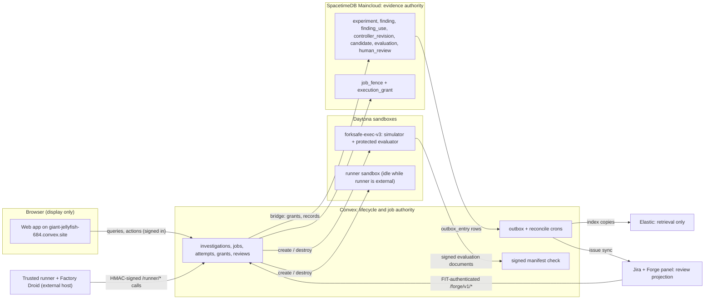
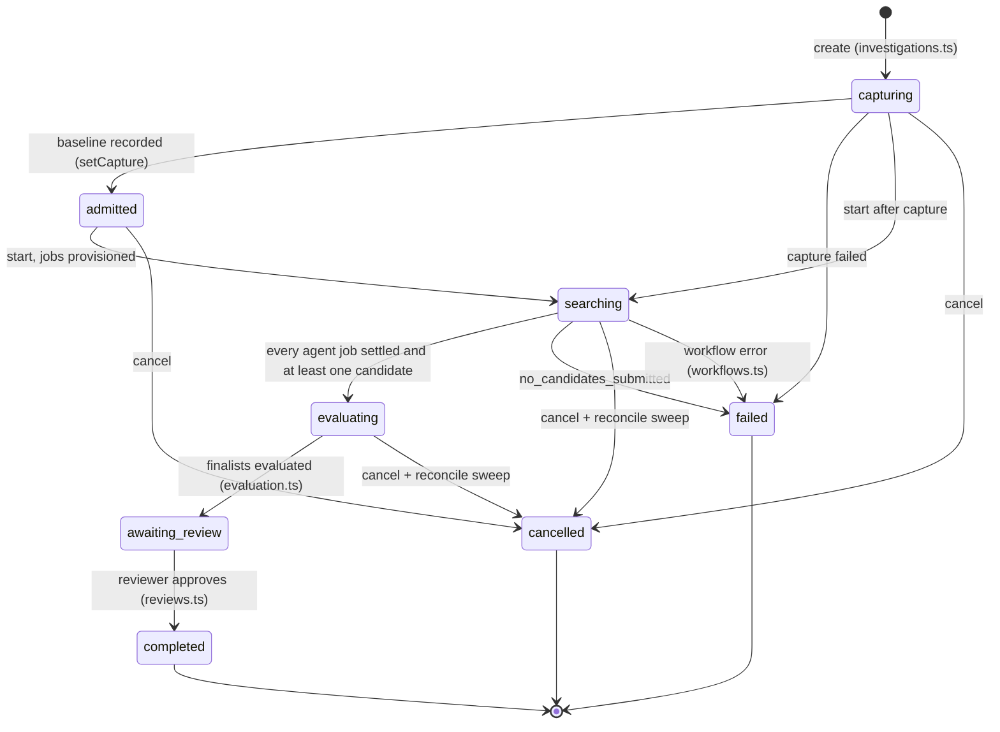

# How ForkSafe is built

This page explains who is in charge of what, and how a robot failure becomes a
reviewed fix. Everything here is taken from the code on `main`; file paths are
given so you can check it yourself.

## The short version

- **Convex** decides what happens next. It owns the investigation, its jobs,
  attempts, sandboxes, budgets and the review decision.
- **SpacetimeDB** (Maincloud database `forksafe`) holds the shared evidence:
  experiments, findings, controller revisions, candidates, evaluations and the
  human review. Agents in different environments read each other's findings here.
- **Daytona** runs the physics. The baseline capture, experiments and every
  protected evaluation run in sandboxes that Convex creates and destroys.
- **Factory Droid** is the agent. A trusted runner process drives it and only
  lets it use five ForkSafe tools.
- **Elastic** is for search only. It indexes copies of the evidence so people
  and the Agent Builder can find it. It never decides a score.
- **Jira and Forge** show the result to reviewers. A Jira issue and a Forge
  panel are projections of the investigation, not a second source of truth.
- **The browser** only displays. It can ask Convex to do things, but it never
  writes evidence or scores directly.

## Authority boundaries

| Piece | What it is allowed to do | Where to look |
| --- | --- | --- |
| Convex | Create and start investigations, claim jobs, fence attempts, create sandboxes, accept evaluations, record reviews | `convex/investigations.ts`, `convex/lib/leasing.ts`, `convex/lib/jobOps.ts`, `convex/evaluation.ts`, `convex/reviews.ts` |
| SpacetimeDB | Store evidence and reject writes that don't carry a live grant | `packages/spacetimedb/src/schema.ts`, `packages/spacetimedb/src/index.ts` (`requireGrant`) |
| Convex to SpacetimeDB bridge | Convex registers with `FORKSAFE_BRIDGE_SECRET`, installs and revokes grants, records rows | `convex/bridge.ts`, `convex/grants.ts`, `convex/lib/spacetime.ts` |
| Runner | Run Factory sessions and call the five agent tools through Convex | `apps/runner`, `packages/agents`, `convex/runnerHttp.ts`, `convex/agentTools.ts` |
| Evaluator | Run a candidate against public and withheld cases in a fresh sandbox and sign the result | `services/evaluator`, `convex/execution.ts`, `convex/lib/signedEvaluation.ts` |
| Elastic | Index projections and answer cited questions | `convex/dispatchers/elastic.ts`, `packages/integrations/elastic` |
| Jira / Forge | Mirror state and accept a reviewer's decision through Convex | `convex/dispatchers/jira.ts`, `convex/forge.ts`, `apps/forge` |
| Browser | Read what it is allowed to see; signed-in, invited users can capture, cancel and review | `apps/web`, `convex/lib/webAccess.ts`, `docs/web-access-control.md` |

## Investigation lifecycle

States come from `InvestigationState` in `packages/contracts/src/enums.ts`.

What happens in each step:

1. **capturing**: a real baseline run executes in a Daytona exec sandbox
   (`convex/capture.ts`, `convex/demo.ts`).
2. **admitted / searching**: Convex reserves budget, creates one runner job per
   environment, and the runners start Factory sessions
   (`convex/investigations.ts`, `convex/workflows.ts`). Agents may run up to 20
   public experiments and submit up to 2 candidates per environment.
3. **evaluating**: each candidate gets a fresh evaluator sandbox, a public suite
   and a withheld suite (`convex/evaluation.ts`). Up to 3 finalists.
4. **awaiting_review**: a person reviews in the web app or Jira. The review must
   name the exact candidate, evaluation and controller SHA-256
   (`convex/reviews.ts` `validate`). An approval moves the investigation to
   **completed**; other decisions are recorded and the state stays put.

## Attempts, epochs and fencing

A job can be retried, so ForkSafe has to make sure that a slow, old attempt can
never overwrite the work of a newer one.

- **Job states**: `reserved`, `grant_pending`, `granted`, `running`,
  `artifacts_pending`, `evidence_pending`, `acknowledged`, then `succeeded`,
  `failed` or `cancelled`. **Attempt states**: `leased`, `heartbeating`,
  `completing`, `succeeded`, `failed`, `expired`, `fenced`
  (`packages/contracts/src/enums.ts`).
- **Claim**: `decideClaim` in `convex/lib/leasing.ts` refuses when admission is
  paused, the investigation is cancelling, dependencies are not done, attempts
  are used up, an old grant is still being revoked, or a lease is still held.
  A successful claim creates a new attempt and bumps the job's **epoch**
  (`convex/lib/jobOps.ts`).
- **Grant**: Convex then installs an `execution_grant` for that attempt and epoch
  in SpacetimeDB (`convex/grants.ts`). Every evidence reducer calls
  `requireGrant` (`packages/spacetimedb/src/index.ts`), which checks the grant
  against the `job_fence` row. A write with an old epoch is rejected there too.
- **Heartbeat and expiry**: the runner heartbeats; `decideHeartbeat` rejects a
  wrong worker or a stale epoch. The `reconcile` cron runs every 5 seconds
  (`convex/crons.ts`, `convex/reconcile.ts`) and uses `decideExpiry` to expire
  attempts whose lease ran out, then revokes their grant.
- **Completion**: `decideComplete` rejects a stale epoch and marks that attempt
  `fenced`. It also refuses to finish until evidence is committed.
- **Handoff stages**: each attempt records `admission_reserved`,
  `grant_installed`, `work_started`, `artifacts_persisted`, `evidence_committed`
  and `completion_acknowledged` with a durable `operationId`. A late write from
  an old attempt is kept as a `stale` row so you can see it, but it changes
  nothing (`convex/lib/jobOps.ts` `recordStageRow`, `convex/lib/handoff.ts`).
- **Runner calls** are signed with a per-environment, expiring credential:
  `hex(HMAC-SHA256(secret, timestamp + "." + body))`, with at most 60 seconds of
  clock skew (`convex/lib/runnerAuth.ts`).
- **Cancel**: cancelling patches open jobs to `cancelled`; after 30 seconds the
  reconcile sweep expires their attempts, releases reservations and terminates
  sandboxes (`convex/reconcile.ts`).

## Outbox and reconciliation

Elastic and Jira are slow, flaky, outside services, so ForkSafe never writes to
them inline. It writes an outbox row and delivers it later.

1. SpacetimeDB reducers add `outbox_entry` rows next to the evidence they
   describe.
2. The `outbox-ingest` cron (every 30 seconds, `convex/outboxIngest.ts`) reads
   pending `outbox_entry` rows and inserts them into the Convex `outbox` table,
   reusing the module's idempotency key, so repeated ticks never duplicate.
3. `outbox.insert` (`convex/outbox.ts`) returns the existing row for a known key
   and queues `dispatchOne` on a Workpool with at most 2 in parallel.
4. `dispatchOne` sends `elastic_index` rows to `convex/dispatchers/elastic.ts`
   and `jira_sync` / `confluence_link` rows to `convex/dispatchers/jira.ts`.
   The Elastic dispatcher re-reads the canonical record from SpacetimeDB and
   validates it before indexing; document IDs are stable, so a redelivery
   overwrites the same document.
5. Failures back off at `min(10 min, 5 s x 2^attempts)` and become `dead` after 8
   attempts. A destination that reports `not_implemented` is retried every
   5 minutes without counting. Operators can retry dead rows with
   `outbox:requeue` (at most 100 at a time).

## Signed evaluation manifests

Scores are only trusted if the evaluator signed them.

- The evaluator (`services/evaluator`, run by `python -m evaluator.run_candidate`)
  runs the candidate's `plan()` in a locked-down child process and the physics in
  a trusted worker, so candidate code cannot change its own score.
- With a signing key present it writes a
  `forksafe.signed_evaluation_manifest.v1` envelope: an Ed25519 signature over
  the controller hash, suite manifest hashes, a digest of every case result,
  simulator, asset and evaluator code hashes, and the IDs
  (`services/evaluator/README.md`).
- Convex checks it before scoring anything. `verifySignedEvaluation` in
  `convex/lib/signedEvaluation.ts` uses the trusted key set in
  `FORKSAFE_EVAL_TRUSTED_KEYS` and fails closed: no keys, an unsigned or
  tampered document, an unknown key, or any mismatch of candidate, attempt,
  controller SHA or suite means nothing is recorded (`convex/evaluation.ts`).
- Withheld cases are delivered only to the fresh evaluator sandbox and consumed
  before candidate code runs (`evaluation/access_policy.md`).

## Where to go next

- [Integration matrix](integration-matrix.md): what is live today.
- [Demo runbook](demo-runbook.md): a 3-minute walkthrough.
- [On-call runbook](operations/runbook.md) and [troubleshooting](troubleshooting.md).
- The full spec: [PRD](ForkSafe_PRD_Handoff.md).
